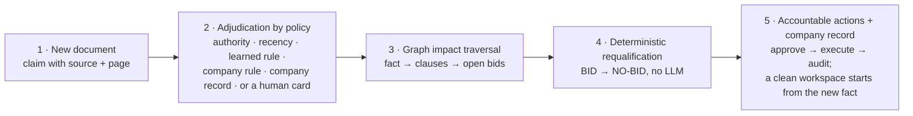
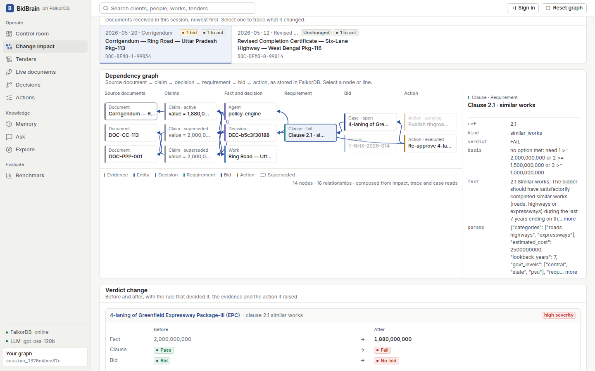
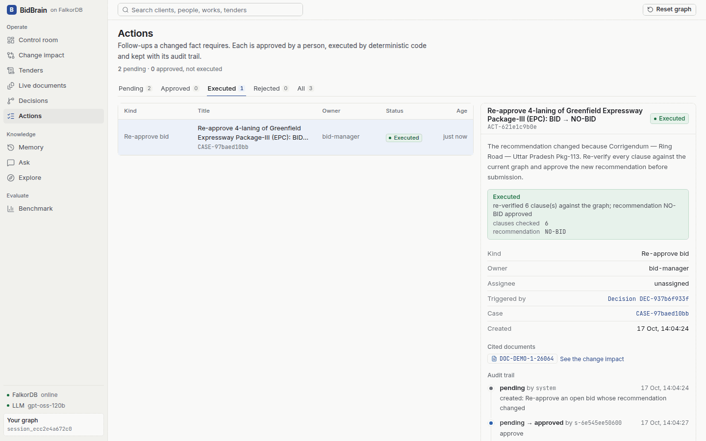
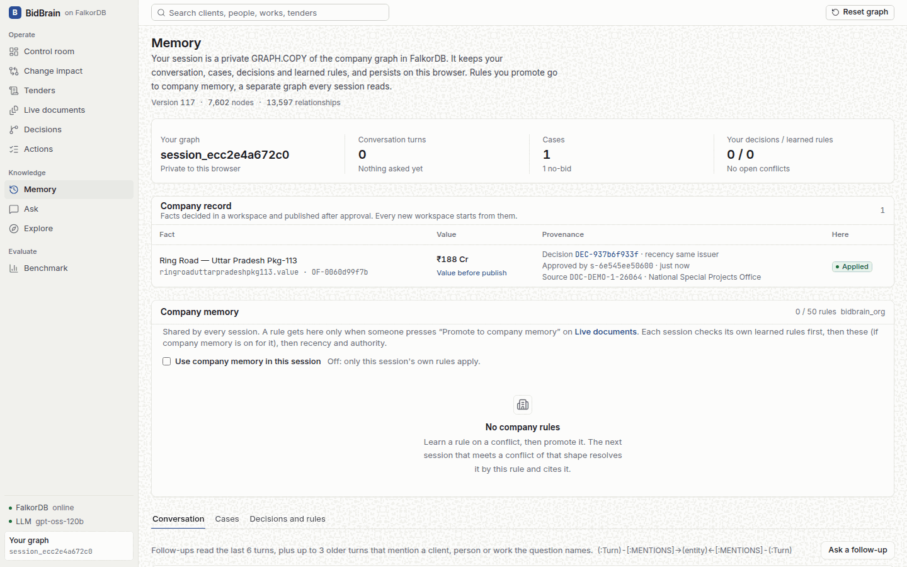
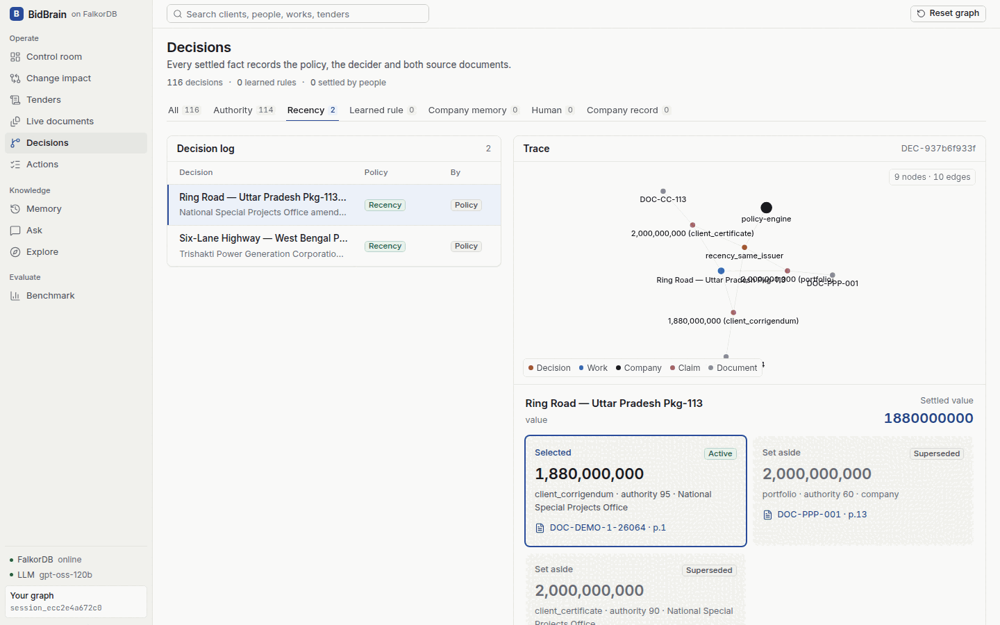
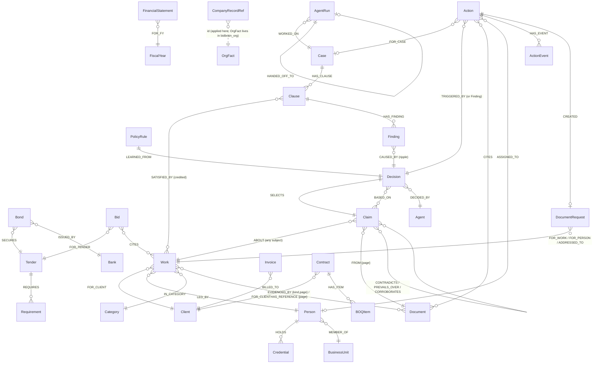
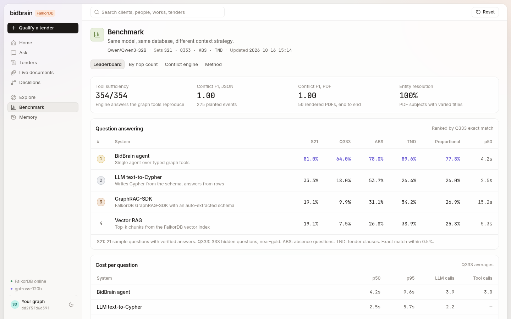

# BidBrain: a company brain on FalkorDB

**BidBrain is a company brain that turns changing evidence into auditable business decisions and coordinated
actions. The construction bid desk is the proving ground.**



An infrastructure firm wins public tenders by **proving** its past: similar works of at least ₹X Cr, qualified key
people, valid bank guarantees, turnover. The proof is spread over hundreds of certificates, letters, CVs and audited
statements, and those documents **contradict each other over time**. BidBrain puts one company's 687 documents into a
FalkorDB graph. When a new document arrives, the graph decides which fact wins and why, finds every open bid that
relied on that fact, re-qualifies those bids without an LLM, and turns the result into actions that a person
approves and deterministic code executes. A fact that the bid manager publishes, once a second person approves it,
becomes part of the company record, and every workspace that opts in to company memory starts from it.

> **TEAM TO FILL IN (the only placeholder in this README):** Live demo: `<!-- DEPLOYMENT-URL -->` not deployed yet ·
> Video: not recorded yet. Until then, run it locally with one `docker compose up` (below).

**Tracks:** Company Brain (lead) · Agents That Act on
Connected Data · Agent Memory & Coordination



## What to look at in 2 minutes

No LLM key is needed for any of this.

1. Open **[/impact](http://localhost:7860/impact/)** (Change impact) and press **Run the demo steps**. It qualifies
   tender T-NHX-2026-014 with rules only, then sends DEMO-0 (a revised completion certificate) and DEMO-1 (a client
   corrigendum).
2. Read the chain for the corrigendum, top to bottom: **document → changed fact (₹200 Cr → ₹188 Cr) → policy
   (recency, same issuer) → affected clause 2.1 (Pass → Fail) → bid verdict (Bid → No-bid) → required actions**.
   Expand **Graph query** to see the Cypher that read the chain.
3. On the *Re-approve bid* action: **Approve**, **Execute**, **Confirm execute**. The executor re-checks every clause
   against the graph and records the approved recommendation. **Actions** shows the audit trail.
4. **Decisions** → *Recency* → the Pkg-113 decision: the trace graph, both sources and their pages.
5. Optional, and it changes the shared company record: approve and execute the *Publish to company record* action,
   then open the app in a private window (a new workspace). **Memory** lists the fact as *Applied*, and **Decisions**
   → *Company record* shows the decision that cites its origin.

| What you see | Where |
|---|---|
| A new document becomes a claim with page, issuer and authority; the policy settles it; the graph finds the open bids it reaches; the bid flips; actions appear | **Change impact** |
| What needs attention: actions to approve, open conflicts, failing cases, verdicts changed by new documents | **Control room** |
| Six agents qualify a tender clause by clause over one case graph; every verdict links to a certificate page | **Tenders** (Qualify) |
| Send sample documents; close calls become cards for a human; "Choose and learn rule"; promote a rule to company memory | **Live documents** |
| Every settled fact traced to its policy, decider and source pages | **Decisions** |
| Pending → approved → executed, with owner, trigger, cited documents and audit trail | **Actions** |
| Company record (published facts), company rules, your workspace's memory | **Memory** |
| "Which works have no reference letter?" with a proof of absence, and a side-by-side with vector RAG | **Ask** (needs an LLM key) |
| Bus factor, isolated entities, client circles, paths between two entities, audit of past bids | **Explore** |
| Graph tools vs. text-to-Cypher vs. GraphRAG-SDK vs. vector RAG, same model | **Benchmark** |


---

## Track mapping

| Track | What BidBrain does | Evidence |
|---|---|---|
| **T3 Company Brain** (lead) | One graph of works, clients, people, credentials, documents, claims, decisions and actions. Values are claims with source and page; a decision selects one and keeps the others. A **company record** (`OrgFact` in `bidbrain_org`) is applied, in workspaces that opt in, through the conflict engine; any workspace can contest it. Bitemporal claims (valid time = the document's own date, transaction time = when the graph recorded it) answer "what did we believe on date T" (`fact_as_of`). | `change_impact`, `fact_history`, `fact_as_of`, `depends_on`; Decisions trace; workflow eval *provenance* 8/8 and *temporal* 4/4; `tests/test_loop_e2e.py` |
| **T1 Agents That Act on Connected Data** | A corrigendum flips a bid, and the system **acts**: a `review_bid` action with an approval gate and a deterministic executor that re-verifies every clause; reference-letter and credential-renewal requests become internal `DocumentRequest` nodes. A planner and six agents qualify tenders over one case graph. 32 graph tools in one registry (31 read, 1 write: `case_open`), served over MCP as 34 tools (32 read-only: the 31 read tools plus `list_actions`; and two acting tools: `qualify_tender`, which acts on a session copy, and `transition_action`). | `company/actions.py`; workflow eval *task_completion* 16/16 and *impact_recall* 18/18 (P = R = 1.0 against an independent recompute); team TND 144/144 (see caveats) |
| **T2 Agent Memory & Coordination** | Agents coordinate through the case subgraph (`AgentRun -[:HANDED_OFF_TO]->`, hand-backs through `Finding`s). Per-visitor `GRAPH.COPY` workspaces. Procedural memory: rules learned from human decisions, optionally promoted to company memory (opt-in, contestable, retireable). Published facts transfer to new workspaces without any private data. Conversation recall through `Turn-[:MENTIONS]->entity`. | workflow eval *memory_transfer* 9/9 and *isolation* 9/9; `tests/test_memory.py`; persistence via RDB + JSON mirror |

## Requirement matrix

| Official requirement | Where it is met |
|---|---|
| Public repository | this repository |
| README with setup and the graph data model | [Run it](#run-it), [Graph data model](#graph-data-model) |
| Cypher queries / graph algorithms the product depends on | [Cypher catalog](#the-cypher-and-algorithms-bidbrain-depends-on) and the generated [docs/CYPHER.md](docs/CYPHER.md) (every query recorded by executing the tool) |
| FalkorDB as the primary database, doing real work | all decisions, impact, actions and company memory are Cypher on FalkorDB; `algo.*`, vector and full-text indexes, `GRAPH.COPY`, `GRAPH.RO_QUERY` |
| Demo video | see the placeholder at the top; script in [docs/DEMO_SCRIPT.md](docs/DEMO_SCRIPT.md) |
| Deployment or local setup | local: `docker compose up --build` ([Run it](#run-it)); hosted URL: see the placeholder at the top |
| Tracks | T3 Company Brain (lead), T1, T2 ([mapping](#track-mapping)) |
| Blog (optional prize) | [docs/BLOG.md](docs/BLOG.md) |

## Judging questions answered

**Does the graph determine decisions?** Yes. Conflict adjudication (`conflicts/engine.py`) reads the competing
`Claim`s and their authority, issuer and dates from the graph and applies a fixed policy order. Tender verdicts come
from `qualify_clause`, which is Cypher plus exact arithmetic. The LLM parses free-text clauses (sample tenders use
vetted clauses) and writes the memo prose; it never chooses a winner or a verdict. If FalkorDB is removed, nothing
works: there is no other store.

**How is the affected set found?** By traversal, not text search. `blast_radius` (`tools/case.py`) walks from the
changed subject to `(:Clause)-[:SATISFIED_BY]->(subject)` on open cases, to past bids that `CITES` it or are `SECURED_BY` its bond, and
to tenders a bond `SECURES`, then re-runs the affected clauses. `change_impact` (`tools/impact.py`) reads the whole
chain back: `(Document)<-[:FROM]-(Claim)<-[:BASED_ON]-(Decision)<-[:CAUSED_BY]-(Finding)<-[:HAS_FINDING]-(Clause)
<-[:HAS_CLAUSE]-(Case)` and `(Decision)<-[:TRIGGERED_BY]-(Action)`. The workflow eval compares the flips it reports
with a separate before/after re-run of every open clause: precision 1.00, recall 1.00 (4/4 flips, 0 false, 198
clause re-checks over 9 events).

**Does memory change a later outcome?** Yes, in two ways, both tested. (1) A published fact: workspace A publishes
the corrigendum value; a new workspace B starts with Pkg-113 = ₹188 Cr, decided by policy `company_record` and
citing the `OrgFact` (`test_corrigendum_to_action_to_company_record`). (2) A promoted rule: a rule learned from a
human decision in A resolves the same shape of conflict automatically in B once B opts in (`tests/test_memory.py`;
workflow eval *memory_transfer* 9/9).

**Can a decision be traced end to end?** Yes: document and page → claim → decision (policy, decider, rationale) →
flipped clause → case verdict → action → `ActionEvent` audit trail → `OrgFact` → the decision in another workspace
that cites it. The workflow eval checks that every evidence row names an existing document and a valid page, and that
every decision `SELECTS` one of its `BASED_ON` claims, each `FROM` a document (*provenance* 8/8).

**What happens on disagreement or missing evidence?** A close call (authority gap under 20, different issuers)
becomes a card for a human; nothing is decided silently. Rounding within the coarser source's precision is not a
conflict. A later but less formal letter does not win by recency. Missing evidence is handled by `prove_absence`,
which returns PROVEN only when the boundary is attested by three views, every letter in the corpus is linked
(corpus closure) and an orphan full-text search is empty; otherwise UNPROVEN. An unknown entity returns
`not_found` with near matches. A Verifier mismatch that survives one retry makes the case **NEEDS REVIEW**. The
adversarial cases are in the workflow eval (*conflict* 16/16).

**What if the LLM fails?** Qualification of sample tenders, live documents, conflict resolution, impact, actions and
the company record use no LLM. The clause parser falls back to the rule parser; the memo falls back to a template.
In Ask, the providers rotate over a pool on rate limits, and if every model fails mid-answer the loop returns a
deterministic answer built from the last successful tool result, marked as such.

**Isolation?** Each visitor gets `GRAPH.COPY bidbrain_base session_<id>`. Only two things cross workspaces, both
explicit: a rule someone promotes, and a fact published through an approved action. The workflow eval checks that
workspace B sees none of A's cases, actions, turns, cards or uploads, and that A's ids return 404 from B
(*isolation* 9/9). MCP read tools run on the base graph as `GRAPH.RO_QUERY`; `qualify_tender` refuses non-session
graphs.

**Deterministic demo without an LLM?** Yes. With no key: the *Run the demo steps* button on /impact (it calls
`/api/qualify` with `use_llm: false`), sending sample events on Live documents, resolving cards, and every action all
run. The workflow eval runs the whole loop with `providers.chat` raising (`llm_calls: 0`).

---

## Architecture

```mermaid
flowchart LR
  subgraph Ingest
    PDF[678 PDFs + 9 xlsx] --> X[vendored extractors] --> F[facts.json]
    F --> L[load_graph.py] --> G[(FalkorDB<br/>bidbrain_base)]
  end
  G -- GRAPH.COPY --> S[(session_&lt;id&gt;<br/>one workspace per visitor)]
  N[new PDF / event] --> CL[claims] --> CE[conflict engine<br/>detect → policy → Decision] --> S
  CE --> BR[blast_radius<br/>re-qualify open clauses] --> AC[Actions<br/>pending → approved → executed]
  AC -- publish_to_company_record --> O[(bidbrain_org<br/>OrgFact · OrgRule)]
  S -- promote a learned rule --> O
  O -. facts, if the workspace opts in .-> CE
  O -. rules, if the workspace opts in .-> CE
  subgraph Agents
    QA[Q&A agent] & CP[ClauseParser] & PL[Planner · no LLM] & EH[EvidenceHunter] & AA[AbsenceAuditor] & CS[ConflictSentinel] & V[Verifier · no LLM] & AS[Assembler]
  end
  T[32 graph tools<br/>Cypher · algo.* · exact maths] --- MCP[MCP server /mcp]
  Agents --> T --> S
  UI[Next.js console] <-- SSE --> API[FastAPI] --> Agents
  LLM[demo: Groq pool<br/>gpt-oss-120b · qwen3.8-27b · gpt-oss-20b<br/>benchmark: Qwen3-32B on vLLM] --- Agents
```



* **One registry, three consumers.** The same 32 tool functions serve the in-app agents, the MCP server and the
  evaluation oracle. The MCP server (`/mcp/`, streamable HTTP, or stdio) exposes 34 tools: the registry's 31 read
  tools plus `list_actions`, annotated `readOnlyHint` (each takes an optional `session_id` to read that session's
  graph), and two acting tools (`readOnlyHint=False`): `qualify_tender`, which runs the tender team on a session's own
  graph copy, and `transition_action` (approve / reject / execute an action in a session). Unknown arguments are
  errors, not ignored. The registry's one write tool, `case_open`, is not exposed.
* **Arithmetic never happens in the LLM.** `aggregate` takes *work keys*, re-reads values from the graph and computes
  in exact integer rupees.
* **Each visitor gets an isolated workspace**: `GRAPH.COPY bidbrain_base session_<id>` on first visit, reaped after
  24 h of inactivity. A copy takes about 0.5 s and 29.5 MB of Redis memory (measured); at most 60 are live.
* **Company memory is explicit.** A learned rule leaves its workspace only when someone promotes it; a fact only when
  a `publish_to_company_record` action is approved by a second party and executed.

## The company loop: decisions, impact, actions, company record

```
new PDF ──► claims (source, page, issuer, authority, recorded_at)
        ──► same (subject, predicate), different value beyond the coarser source's precision?
              └─► (a)-[:CONTRADICTS]->(b)
        policy, in order:
           1. a claim carries a published company-record fact    → auto, policy company_record (cites the OrgFact)
           2. a PolicyRule learned in this workspace matches      → auto, learned_rule (cites the rule)
           3. a company rule in bidbrain_org matches (opt-in)     → auto, org_rule (cites the rule and its source)
           4. the same issuer amended itself, at least as formally → auto, recency_same_issuer
           5. authority gap ≥ 20 on the ladder                    → auto, authority
           6. otherwise                                           → a card for a human
        every outcome ──► (:Decision)-[:SELECTS]->(winner), -[:BASED_ON]->(all), -[:DECIDED_BY]->(agent|user)
                          the loser keeps its value: status superseded/rejected, invalidated_at set
        ──► blast_radius ──► re-run affected clauses ──► (:Finding {kind:'ripple'})-[:CAUSED_BY]->(:Decision)
        ──► actions: review_bid per changed case, publish_to_company_record per decided fact
```

Authority ladder: client corrigendum 95 · bank notice 95 · audited statement 95 · revised certificate 92 · client
certificate 90 · reference letter 80 · final bill 75 · JV partner certificate 75 · company record 70 · portfolio 60 ·
comparative column 50 · CV 40 · LLM-read prose 30.

**Accountable actions** (`backend/bidbrain/company/actions.py`). Four kinds: `review_bid` (created by a ripple that
changed a recommendation), `request_reference_letter` and `renew_credential` (created from the AbsenceAuditor's
absence and expiry findings, owned by the work's lead or the named person), and `publish_to_company_record` (created
for a decided fact). Lifecycle `pending → approved → executing → executed`, or `→ rejected` from pending or
approved; `superseded` when the reason no longer holds (a `review_bid` whose case moved on, a finding that no longer
applies) and `fulfilled` when an arriving reference letter answers a letter request (it also resolves the matching
absence finding). A ripple re-derives findings and their follow-up actions.

* **Idempotent creation:** `MERGE (a:Action {idem:$idem})`, where `idem` hashes (kind, case, trigger, target), so a
  repeated ripple never doubles the queue.
* **Execute claims first:** a CAS `approved → executing` before the executor runs, so two executes cannot both run;
  a failed executor hands the action back to `approved`.
* **Compare-and-set transitions:** `MATCH (a:Action {id:$a}) WHERE a.status IN $frm SET a.status = $to`. A stale
  click gets HTTP 409; a repeated click gets the same answer and no second event. Execute before approve is 409.
* **Deterministic executors only.** `review_bid` re-runs `qualify_clause` on every clause and refuses (409) if any
  stored verdict disagrees; otherwise it sets `Case.approved_recommendation`. Letter and renewal requests create an
  internal `(:DocumentRequest {channel:'internal'})`. **No email is sent**; there is no email integration.
  `publish_to_company_record` calls `record.publish`. Execute is idempotent: a repeat returns the stored result.
* **Audit:** every transition writes `(:Action)-[:HAS_EVENT]->(:ActionEvent {at, from, to, by, note})`.



**Company record** (`backend/bidbrain/company/record.py`). Publishing copies exactly one decided fact into
`bidbrain_org` as an `(:OrgFact)` with its claim, its source document, the source decision and policy, the
publishing workspace's hashed tag and the approver. Nothing else crosses: no turns, cases or other claims. Publishing needs **two people**:
the session that queued the publish cannot approve it; its approve files a `PublishRequest` that a *different*
session approves on the **Memory** page (or an operator approves with `ORG_ADMIN_TOKEN`), and the `OrgFact` records
both `published_by` and `approved_by`. When a workspace that turned on **Use company memory** (off by default, the
same switch as company rules) is opened, `record.apply` writes each active fact it has not yet seen (tracked by `(:CompanyRecordRef)`)
as a claim plus its source document, and the **conflict engine** settles it with policy `company_record`, citing the
`OrgFact`. A newer fact for the same subject and predicate supersedes the older one (kept, status `superseded`).
Only the publishing workspace (or an operator with `ORG_ADMIN_TOKEN`) can retire a fact; a retired fact stays in the
record with status `retired`. Retiring propagates: every workspace that applied the fact notices on its next
request, the fact's claim is withdrawn (policy `record_withdrawn`), the engine decides the fact again and the change
ripples to cases. An applied fact is not a trump card: newer or higher-authority evidence can beat it or open a card,
and any workspace can contest it (`POST /api/company/record/{id}/contest`), which reopens the decisions it made there
as resolve cards; nothing is auto-rejected. Planted evaluation claims can never be published.



**Bitemporal claims, two axes.** *Valid time:* a claim counts as of T only if the document stating it existed by
T, using the date the document prints (parsed at ingest into `Document.issued_day`; certificates, letters, bonds,
statements, bills and dossiers carry one), else the claim's `observed_day`. CVs, the portfolio, ISO certificates and
ledgers print no date: their claims count from the corpus snapshot (2026-03-31), and `fact_as_of` says so in
`undated_kinds`. *Transaction time:* the graph must have recorded the claim by T (`recorded_at`; the corpus is the
starting record at 0, because the base graph is rebuilt at every boot and a rebuild must never change history), and
it stops counting once a decision sets it aside (`invalidated_at`). Decisions count from their own `at` (the corpus's
own decisions: 0). `fact_as_of(key, predicate, as_of)` returns the value believed then, with each claim's recorded
and valid dates, what was learned later, what was not yet issued, and what has been set aside since. Asked for
FY2024-25 revenue as of 2021-01-01, it returns nothing: those accounts are dated 2026-03-31.



The corpus contains **real** conflicts: each audited statement's comparative "previous year" column disagrees with
that year's own statement on 114 fields. All 114 are settled at boot (own statement 95 beats comparative column 50)
and remain visible as Decisions. ₹193,299,999 on a certificate against ₹193,300,000 in the portfolio is treated as
**rounding**, not a conflict.

## Graph data model



| Layer | Nodes (count in base graph) | Purpose |
|---|---|---|
| Company records | `Work` 155 · `Client` 29 · `Person` 39 · `Credential` 48 · `Category` 13 · `Tender` 63 · `Requirement` 491 · `Bond` 60 · `Invoice` 518 · `Contract` 6 · `BOQItem` 43 · `Measurement` 407 · `FinancialStatement` 8 · `Asset` 210 · `Certification` 5 | the connected estate: every edge is a join the questions need |
| Provenance | `Document` 687 · `Chunk` 2,564 (fulltext + 384-d HNSW vector index) | every fact links to a document and page |
| Claims | `Claim` 1,668, each with `recorded_at` and, once set aside, `invalidated_at` | every contestable value with source, page, issuer, **authority**, date; valid time (document date) and transaction time for `fact_as_of` |
| Decisions | `Decision` (114 at boot) · `PolicyRule` · `ConflictCard` | how disagreements were settled, by whom, and why |
| Work in progress | `Case` · `Clause` · `Finding` · `AgentRun` | the tender team's shared state |
| Actions | `Action` · `ActionEvent` · `DocumentRequest` | follow-ups with trigger, owner, approval gate, executor result and audit trail |
| Memory | `Bid` 6 (past bids) · `Conversation` · `Turn` · `CompanyRecordRef` (in each workspace) · `OrgRule` · `OrgFact` (in `bidbrain_org`) | episodic, procedural (learned and promoted rules) and the company record |

Dates are also stored as integer `*_day` fields, so filters compare integers. Entity properties such as `Work.value`
are a **materialized view of the winning claim**: nothing is overwritten when a corrigendum arrives.

## The Cypher and algorithms BidBrain depends on

The full catalog is in **[docs/CYPHER.md](docs/CYPHER.md)**. It is generated by `scripts/gen_cypher_doc.py`, which
executes every tool and records the queries it actually ran, plus the engine, action and company-record writes.
The core ones:

| Tool | What the graph does |
|---|---|
| `change_impact` | `(Document)<-[:FROM]-(Claim)-[:ABOUT]->(subject)`, `(Decision)-[:BASED_ON]->(claim)`, `-[:SELECTS]->(winner)`; then `(Decision)<-[:CAUSED_BY]-(:Finding {kind:'ripple'})<-[:HAS_FINDING]-(:Clause)<-[:HAS_CLAUSE]-(:Case)` and `(Action)-[:TRIGGERED_BY]->(Decision)`: one document's whole effect, read from the graph |
| `blast_radius` | `(subject)<-[:SATISFIED_BY]-(:Clause)<-[:HAS_CLAUSE]-(:Case)`, `<-[:CITES\|SECURED_BY]-(:Bid)` (a past bid cites only its Annexure D works in the tender's category), `-[:SECURES]->(:Tender)`, then re-runs the affected clauses and reports verdict flips |
| `fact_as_of` | the claims about one fact whose document is dated on or before T (valid time), with `recorded_at ≤ T` and not set aside by T (transaction time); the latest decision with `at ≤ T` picks the winner, else the highest authority |
| `depends_on` | provenance as a variable-length match, `MATCH p = (x)-[:FROM\|EVIDENCED_BY\|HAS_REFERENCE\|HOLDS\|BASED_ON\|SELECTS\|CITES\|...*1..4]->(:Document {doc_id:$doc})`: everything that rests on one document, and which facts it is the *only* source for |
| `fact_history` | every competing `Claim` about a fact with document and page, and the `Decision`s (policy, decider, learned rule) that settled it |
| `find_portfolio` | `MATCH (w:Work)-[:FOR_CLIENT]->(c:Client), (w)-[:LED_BY]->(p:Person), (w)-[e:EVIDENCED_BY {kind:'completion_certificate'}]->(d)` with client / person / **via-work hop** / category / value / date / govt-level filters |
| `prove_absence` | boundary `(c:Client)<-[:FOR_CLIENT]-(w)`, partition on `(w)-[:HAS_REFERENCE]->()`, then three checks: 3-view attestation, **corpus closure** (every letter is linked to some work), and a full-text orphan search |
| `qualify_clause` | CPWD 80/60/40% similar-works rule, turnover (conflict-aware), key personnel valid **on the bid date**, certifications, years in business from the CIN |
| `key_people` | the bus factor as **exact** betweenness: Brandes in one Cypher query, `MATCH p = allShortestPaths((a)-[:WORKED_FOR*]-(b))` over every pair of the 65 people and clients with a `WORKED_FOR` edge (37 + 28; 2,080 pairs) (~0.1 s). `algo.betweenness` samples source nodes even with `samplingSize` above the node count, so it is reported beside it as a cross-check (32-seed mean: same top 3 in order, 4/5 of the top 5, 9/10 of the top 10) |
| `explain_path` | `CALL algo.SPpaths({sourceNode, targetNode, relTypes, relDirection:'both', maxLen:6, pathCount:3})` |
| `isolated_entities` | `CALL algo.WCC(...)` over the evidence edges: everything outside the main component is a finding, such as documents no fact cites or staff with credentials who never led a work |
| `communities` | `CALL algo.labelPropagation(...)` over `OVERLAPS_CLIENTS` (two leads who share at least 1.5× the clients the configuration model expects): 3 client circles of 15 / 12 / 10 people, **modularity 0.203** (random splits of the same sizes: −0.021; a greedy optimiser: 0.21) |
| `trace_from_credential` | the 5-hop credential → person → work → client → portfolio → certificate chain in one Cypher query |
| `compliance_check` | re-tests every MET row in the company's past compliance matrices (491 `Requirement` nodes) against the graph *on the date the claim was made*: 318 checkable: 194 agree, 119 disagree, 5 unconfirmed; 105 of the 119 are most likely synthetic-generator artifacts, and the tool says so |
| `vector_search` / `fulltext_search` | `db.idx.vector.queryNodes('Chunk','embedding',k,vecf32($v))` / `db.idx.fulltext.queryNodes('Chunk',$q)` |
| `cypher_readonly` | the agent's escape hatch, executed as `GRAPH.RO_QUERY`, so the server rejects writes |
| actions | `MERGE (a:Action {idem:$idem}) ON CREATE SET ...`; transition `MATCH (a:Action {id:$a}) WHERE a.status IN $frm SET a.status = $to`; `CREATE (a)-[:HAS_EVENT]->(:ActionEvent {...})` |
| company record | `MERGE (f:OrgFact {id:$id}) ON CREATE SET ...` in `bidbrain_org`; applied per workspace as a `Claim` with `company_record = $f`, then settled by the conflict engine |
| tenancy | `GRAPH.COPY bidbrain_base session_<id>`; company rules and facts live in a separate `bidbrain_org` graph |

## Agents

**Tender team: a planner, six agents, one case graph.**

| Agent | Uses LLM | Writes to the case graph |
|---|---|---|
| ClauseParser | only for new or edited text (sample tenders keep vetted clauses; rule-parser fallback) | `(:Clause {kind, params})` |
| Planner | no | the plan on the `Case` node: which agents run on which clauses |
| EvidenceHunter | no | `(:Clause)-[:SATISFIED_BY {credited}]->(Work \| Person \| FinancialStatement \| …)`, verdicts |
| AbsenceAuditor | no | `(:Finding {kind:'absence'\|'expiry'\|'gap'})`: missing letters (with proof), PMPs lapsing before the bid, near misses |
| ConflictSentinel | no | findings for every relied-on fact with a contested or overturned claim, citing the Decision |
| **Verifier** | **no** | re-runs every clause against the graph and, independently of the parser, checks every threshold against the amounts written in the clause text (including "X% of the estimated cost", resolved from the tender header, and cumulative `min_total`); a disagreement sends the clause back to the EvidenceHunter once, and only if it persists is the recommendation **NEEDS REVIEW**. A known clause the parser could not read is NEEDS REVIEW, never a pass |
| Assembler | yes (template fallback) | the bid memo: verdict per clause, an evidence table (document + page for every item relied on), gaps, precedent past bids |

Each agent is an `(:AgentRun)`; handoffs are `(:AgentRun)-[:HANDED_OFF_TO]->(:AgentRun)` in the order the runs
happened. **Hand-backs** go through the graph too: when the AbsenceAuditor finds that the works a clause relies on
have no reference letter, it leaves a request on the `Finding`, and the EvidenceHunter runs again (a second
`AgentRun` with `pass_no`) and re-selects referenced works, keeping them only if the clause still passes. After a
run, the open absence and expiry findings become `request_reference_letter` and `renew_credential` actions.

**Q&A agent.** A thin OpenAI-compatible tool loop over 26 of the 31 read tools (23 during the benchmark runs), with no agent framework. The prompt
teaches how to *use the graph* and leaves domain knowledge to the tools. An **unasked-filter guard** checks every
narrowing filter the model sets against what the user asked. **One model per answer**: later steps prefer the
provider that served the first step. Follow-ups recall up to 3 older turns that `MENTIONS` an entity the question
names, before the last-6-turn window.

## Evaluation

### Workflow evaluation (deterministic, no LLM)

`backend/eval/workflow.py` scores the **company loop** itself, with no LLM (`providers.chat` raises), on throwaway
graphs only: FastAPI TestClient against the real API, session copies and a private company graph, all deleted
afterwards; the run checks that `bidbrain_base` and `bidbrain_org` are unchanged. Each expectation comes from the
fixtures (`demo_events.json`, `demo_tenders.json`), from separate Cypher, or from re-running `qualify_clause` on a
graph copy, never from the function being tested. Last run: 81 cases, 25.5 s, 0 LLM calls
(`data/eval/workflow_summary.json`, per-case rows in `data/eval/results/workflow.jsonl`).

| Dimension | Cases | Passed | What is checked |
|---|---:|---:|---|
| task_completion | 16 | 16 | corrigendum → review_bid → approve → execute sets `approved_recommendation`; renewal and letter actions create a `DocumentRequest`; renewal actions only for credited people whose credential lapses; rejected actions never run; execute is idempotent; a duplicate ripple adds no action; the session that queued a publish cannot approve it (`tc.publish_not_self_approved`) |
| impact_recall | 18 | 18 | 9 events (DEMO-0..4, plus corrigenda aimed at T-RBC-2026-31 and T-JN-LB-2026-09). The flips `/api/impact` reports match a separate before/after re-run of every open clause: (case, clause) precision 1.00 and recall 1.00 (4/4 flips, 0 false), 198 clause re-checks |
| conflict (adversarial) | 16 | 16 | rounding vs just-past-precision; unrelated corrigenda (different subject or predicate) flip nothing; same-issuer recency; a later but less formal letter does not win by recency; close authority goes to a human; credentials expired at the bid date; absence PROVEN vs UNPROVEN (broken closure, unlinked letter text); aliases (`ISRO` not found, `phed odisha` resolves) |
| memory_transfer | 10 | 10 | a promoted rule applies in another session only after opt-in; contest/retire reopens; a published fact applies in new and existing workspaces with policy `company_record`, citing its OrgFact, and only where the workspace opted in (`mt.company_fact_needs_opt_in`) |
| isolation | 9 | 9 | session B sees none of A's cases, actions, turns, cards or uploads; A's ids return 404 from B; MCP `qualify_tender` refuses non-session graphs |
| temporal | 4 | 4 | `fact_as_of` before the certificate's own date, and 5 ms before and after the corrigendum; superseded claims keep their value and `invalidated_at` |
| provenance | 8 | 8 | every evidence row names an existing Document and a valid page; every Decision SELECTS one of its BASED_ON claims, and each of those comes FROM a document |
| **total** | **81** | **81** | conflict detection P/R is not repeated here (see below: 275 events, P = R = 1.0) |

An earlier run scored 78/79. The failure was a real product finding: `renew_credential` actions were created for
every PMP holder whose credential lapsed within 90 days, including people not proposed on the clause. Renewal
actions are now created only for the people the expiry finding names; the current 81/81 run is on that code.

The same team wrote the fixtures, the checks and the code, so this evaluation shows the loop is consistent and
complete on the scenarios we designed, not that it generalises.

| Other gates | Result |
|---|---|
| **Tool sufficiency**: graph tools, given the deterministic engine's parsed parameters, reproduce its answers | **354 / 354**, and **21 / 21** on true gold |
| Conflict engine, JSON stream: 275 events, 200 conflicts + 75 hard negatives (rounding, unchanged restatements, unrelated fields) | P = R = F1 = **1.00**, routing 1.00, winner 1.00 |
| Conflict engine, **PDF path**: 50 rendered PDFs → extraction → entity resolution → detection | F1 **1.00** (first run: F1 0.976 and extraction 86.7%, which exposed 2 real bugs, both fixed) |
| End-to-end loop through the API, no LLM (`backend/tests/test_loop_e2e.py`, 4 tests; 118 tests in `backend/tests` overall) | 4/4 pass (re-run 17 Oct) |

### Answer-accuracy benchmark (LLM)

<a id="benchmark-status"></a>
> **Benchmark status: final (17 Oct 2026, 17:50 IST).** The numbers below are from the final code (commit
> `80b5356`), two independent runs per system with fresh LLM caches, on Qwen3-32B (FP8, one H100, vLLM). GraphRAG-SDK
> is the exception: one run, from 17 Oct 07:33 on the bf16 model (its ingest takes hours). Run 1 is the headline;
> run 2 and the mean are in `qa_summary.json` under `repeat_run`.
>
> **Changed since the benchmark ran.** After `80b5356` the Q&A agent gained: a re-ask when it answers without
> calling a tool; a lexical grounding check (names, ids and amounts must appear in a tool result); a post-check that
> adds names `prove_absence` found missing; `list_cases`, `fact_as_of` and `change_impact` in its toolset (26 tools,
> 23 during the runs); model-pin and wait changes; and a deterministic fallback answer. The benchmark numbers predate
> all of these and have not been re-measured.

All systems use **the same model (Qwen3-32B on vLLM)** and **the same FalkorDB instance**; only the context strategy
differs. **The benchmark model is not the demo model**: the demo app runs on a pool of free Groq models
(openai/gpt-oss-120b, qwen/qwen3.8-27b, openai/gpt-oss-20b), because Groq no longer serves Qwen3-32B. The benchmark
measures the strategies, not the deployed model.

| System | S21 (independent gold, 21) | ABS (absence, 164) | TND (tender, 144) | Q333 (engine-derived near-gold, 333) |
|---|---|---|---|---|
| **BidBrain agent**, run 1 | **.762** [.549, .894] | **.835** [.771, .884] | **.931** [.877, .962] | **.703** [.652, .749] |
| BidBrain agent, run 2 · mean | .810 · .786 | .884 · .860 | .924 · .927 | .703 · .703 |
| LLM text-to-Cypher, run 1 | .333 [.172, .546] | .500 [.424, .576] | .361 [.287, .442] | .147 [.113, .189] |
| text-to-Cypher, run 2 · mean | .429 · .381 | .482 · .491 | .410 · .385 | .153 · .150 |
| GraphRAG-SDK (auto schema, all 678 docs; one run, bf16) | .190 [.077, .400] | .311 [.245, .385] | .542 [.460, .621] | .099 [.071, .136] |
| Vector RAG, run 1 | .238 [.106, .451] | .268 [.206, .341] | .403 [.326, .484] | .069 [.046, .102] |
| vector RAG, run 2 · mean | .238 · .238 | .262 · .265 | .396 · .399 | .066 · .068 |
| Constant answer (always 0 / majority) | .190 | .427 | .472 | .045 |

Exact match, temperature 0; brackets are 95% Wilson intervals (`accuracy_ci95` in `data/eval/qa_summary.json`).
By hop count on Q333 (2-3 / 4 / 5-6 hops): BidBrain .86 / .79 / .62, text-to-Cypher .34 / .02 / .16, GraphRAG-SDK
.00 / .07 / .14, vector RAG .00 / .06 / .09. Cost per Q333 question (run 2, all live): BidBrain 4.1 LLM calls, ~18k
tokens, p50 5.5 s; text-to-Cypher 2.2 calls, ~1.5k tokens, 2.7 s; vector RAG 1 call, ~3.5k tokens, 7.6 s;
GraphRAG-SDK p50 15.2 s.



Caveats:

* **Gold sources differ.** **S21 is independent gold.** **Q333 is engine-derived near-gold**: its gold is our earlier
  deterministic engine's output (99.775 on the hidden leaderboard), and our tools reproduce that engine (354/354), so
  Q333 flatters BidBrain. ABS and TND gold comes from independent Cypher and a separate re-implementation of the
  rules (`eval/synth.py`), not from BidBrain's tools. S21 (n = 21) is too small to rank systems on its own.
* **Six-agent team on TND: 136/144 before a fix, 144/144 after; 144/144 on the final code; 0 LLM calls.** This
  measures the deterministic graph pipeline, not an LLM. All 8 first-run misses were one parser bug ("buildings" also
  matched "small buildings"), and **the fix was found on the test set**, so treat 144/144 as tuned on it.
* **Two runs on the final code, and what changed before them.** A first final run (kept in
  `data/eval/results/final_v1/`) scored BidBrain .714 / .872 / .944 / .694 (S21 / ABS / TND / Q333). Reading its S21
  misses, we found two regressions we had introduced the same day and fixed them before the two reported runs: the
  agent misused the newly offered `trace_from_credential` tool (now MCP and Explore only), and the unasked-filter guard
  ignored amounts written in words ("the six crore line"). Both are general fixes, but they were found on S21, so S21
  is not a clean held-out set for them. Run 1's rows were replayed from run 1's own completion cache after a file
  mix-up (identical by construction; 10 of 333 Q333 completions were re-requested live), which is why
  `cached_rows` is non-zero for it; run 2 is fully live. Earlier pre-final runs are in `run1/` and `run2_prefinal/`.
* **Run-to-run variance is real.** BidBrain moved 1 of 21 questions on S21 (.762 vs .810, 16 vs 17) and 8 of 164 on
  ABS between two runs at temperature 0. Read the mean and the intervals, not the point.
* **Model.** The final runs used Qwen3-32B in FP8 on one H100 (the cluster's H200 allowance was taken); the pre-final
  runs and GraphRAG-SDK used bf16 on an H200.
* **Constant answers are informative.** On ABS, always answering 0 (.427) beats vector RAG and GraphRAG-SDK; on TND,
  the majority verdict (.472) beats text-to-Cypher and vector RAG.
* **GraphRAG-SDK** chose its own schema with no hand-written ontology, which would likely raise its score. It ingested
  every document with its own LLM extractor on the same model; 6 chunk-level relation steps hit the 32k context.
* **Cost:** BidBrain spends about 12× the tokens of text-to-Cypher per question.
* **Not modelled:** JV works are credited at full value (the corpus has no share %); there is no bank-guarantee clause.
* The conflict rules and the planted labels were written by the same team, so the JSON path mostly checks
  consistency; the PDF path adds parts that can genuinely fail, and its first-run numbers are reported.

## Run it

**Docker (recommended).** One container: FalkorDB, the FastAPI API, MCP and the static UI.

```bash
cp .env.example .env          # optional: GROQ_API_KEY / CEREBRAS_API_KEY for Ask and the LLM memo
docker compose up --build     # http://localhost:7860  (UI + API + MCP at /mcp/)
```

The image builds the UI, installs the Python dependencies, bakes in the embedding model and fetches the pinned
synthetic corpus. At boot, `infra/start.sh` starts FalkorDB, rebuilds `bidbrain_base` from `data/facts.json`
(about 2 s), renders the demo PDFs and starts the API on port 7860. Without Docker Compose:
`docker build -t bidbrain . && docker run -p 7860:7860 --env-file .env bidbrain`.

**Deterministic demo path, no LLM key.** Leave `.env` empty. Then:

1. **Change impact** → **Run the demo steps** (qualifies T-NHX-2026-014 with `use_llm: false`, sends DEMO-0 and
   DEMO-1), or on **Tenders** run any sample tender (vetted clauses; the memo uses its template).
2. **Live documents** → **Send** any sample event; close calls appear as cards to **Choose** or **Choose and learn
   rule**.
3. **Actions** → approve, reject or execute.

All of these work without keys. Only **Ask** (free-text questions) needs an LLM.

> **What persists.** The base graph (`bidbrain_base`) is rebuilt from facts at every boot. Company memory (`bidbrain_org`) and session graphs are saved by FalkorDB as RDB snapshots in `$BIDBRAIN_STATE_DIR/falkordb` (default `/app/state`): at most every 5 minutes if anything changed, and on a clean stop. Company memory is also mirrored to `$BIDBRAIN_STATE_DIR/org_memory.json` after every promote, retire or contest, and restored from it at boot if the graph is missing. With `docker compose`, all of this lives in the `bidbrain-state` volume (`docker compose down -v` wipes it). On Hugging Face Spaces the disk is ephemeral unless persistent storage is enabled (then set `BIDBRAIN_STATE_DIR=/data`). Governance: company rules apply only in sessions that turn on "Use company memory" (off by default); provenance is the promoting session's hashed tag; only the promoting session can retire a rule; any other session can contest it; new sessions are rate-limited to 10 per minute per IP.

The JSON mirror also carries the company record: published `OrgFact`s are written to it after every publish and
retire of a fact, and restored with the rules. Like company rules, published facts apply only in workspaces that turn on
"Use company memory"; publishing needs a second approver, and only the publishing workspace can retire one.

**Development**

```bash
docker run -d -p 6379:6379 falkordb/falkordb:latest
cd backend && uv venv --python 3.12 .venv && uv pip install -r requirements.txt && source .venv/bin/activate
# the corpus is not vendored; fetch the pinned commit the facts were extracted from
git clone https://github.com/satvikGIKA/BITS-Hackathon-Dataset vendor_bidintel/dataset
git -C vendor_bidintel/dataset checkout 707c80fc7a57dad0c0f58cb4b305f4ecfba27c8a
python -m bidbrain.ingest.load_graph          # builds bidbrain_base (~2 s)
uvicorn bidbrain.api.main:app --port 7860     # keep running; open a second terminal for the UI
```

```bash
cd frontend && npm ci && NEXT_PUBLIC_API_BASE=http://localhost:7860 npm run dev
```

**Connect an MCP client** (Claude Desktop, etc.): point it at `/mcp/` (streamable HTTP) on your running instance, or
run `python -m bidbrain.mcp.server` for stdio. The 32 read-only MCP tools (the registry's 31 read tools plus `list_actions`) run against the pristine base graph,
or against an existing session's graph when given its `session_id`; `qualify_tender` acts on a session copy (pass
`session_id='new'`) and `transition_action` moves a session's actions.

**Reproduce the evaluation** (from `backend/`)

```bash
python -m eval.workflow                     # company-loop evaluation, no LLM (~25 s; 81/81)
python -m eval.workflow --report            # table of the last run
python -m pytest tests                      # includes tests/test_loop_e2e.py
python -m eval.oracle                       # tool sufficiency gate (354/354)
python -m eval.conflict_pr                  # planted conflict stream, JSON path
python -m eval.conflict_pdf --per-type 5    # render → extract → resolve → detect
python -m eval.synth                        # ABS + TND sets with independent gold
LLM_PROVIDERS=vllm python -m eval.run --system bidbrain --set Q333   # Qwen3-32B on vLLM
python -m eval.run --summarize
```

## Repository

```
backend/bidbrain/ingest     graph loader, claims, page provenance, aliases, past-bid dossiers, chunks+embeddings
backend/bidbrain/tools      the 32 graph tools: 31 read + `case_open` (one registry → agents, MCP, eval); impact.py: change_impact, fact_as_of
backend/bidbrain/conflicts  conflict engine, company memory (rules), planted events, PDF rendering + live ingestion
backend/bidbrain/company    actions.py (accountable actions), record.py (company record)
backend/bidbrain/agents     provider failover + cache, tool loop, Q&A agent, tender team, baselines
backend/bidbrain/api        FastAPI + SSE, per-session graphs, conversation memory
backend/bidbrain/mcp        MCP server (stdio + streamable HTTP)
backend/eval                workflow eval, oracle, conflict P/R (JSON + PDF), synthesized sets, benchmark runner
backend/tests               118 tests, including the end-to-end loop
backend/vendor_bidintel     reused extraction layer (credited below); not FalkorDB code
frontend/                   Next.js (static export) console + react-force-graph
infra/                      container entrypoint, Sharanga vLLM job
docs/                       CYPHER.md · EXPLAINER.md · DEMO_SCRIPT.md · BLOG.md
```

## Reuse, credits and AI disclosure

* **Data**: the synthetic construction-company corpus from the BITS Hackathon "Bid Intelligence" challenge,
  [satvikGIKA/BITS-Hackathon-Dataset](https://github.com/satvikGIKA/BITS-Hackathon-Dataset) (MIT). It is fully
  synthetic; no real company or person.
* **Reused code**: `backend/vendor_bidintel/` is the PDF/xlsx extraction layer that our team members (Shoyam Mishra,
  Atharv Gaur) wrote for that earlier hackathon, vendored unchanged and credited. It produces `facts.json` and
  contains no FalkorDB code, no agents and no conflict handling. That earlier project was a regex question parser
  over a fact table.
* **Net-new for Graph Hacks**: everything under `backend/bidbrain/`, `backend/eval/`, `backend/tests/` and
  `frontend/`: the graph model and loader, the claim layer and conflict engine, all 31 Cypher tools, the tender team
  and Q&A agent, change impact, accountable actions, the company record, bitemporal claims, session tenancy and
  company memory, the MCP server, the console UI, and every evaluation (workflow eval, oracle, conflict P/R, ABS/TND
  synthesis, benchmark runner and baselines).
* **AI assistance**: this project was built with extensive help from AI coding assistants (Claude Code) for code
  generation, refactoring, tests and documentation, under the team's direction and review. The team chose the
  architecture, the data model, the policies and the evaluation design, and can explain every part of the code;
  [docs/EXPLAINER.md](docs/EXPLAINER.md) is the guide we use for that.
* **Built on** FalkorDB (graph, vector and full-text indexes, `algo.*`, `GRAPH.COPY`), FastAPI, the MCP Python SDK,
  fastembed (bge-small-en-v1.5), Next.js and react-force-graph. LLMs: a pool of free Groq models for the demo
  (openai/gpt-oss-120b, qwen/qwen3.8-27b, openai/gpt-oss-20b) and Qwen3-32B on vLLM for the benchmark.
