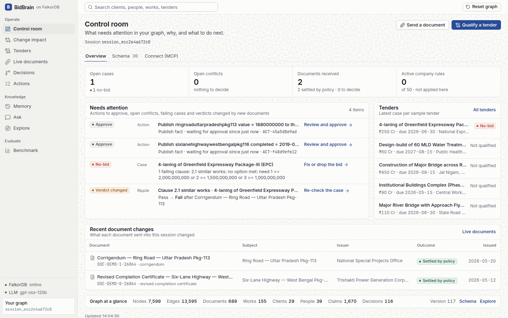
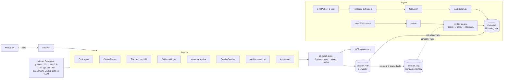
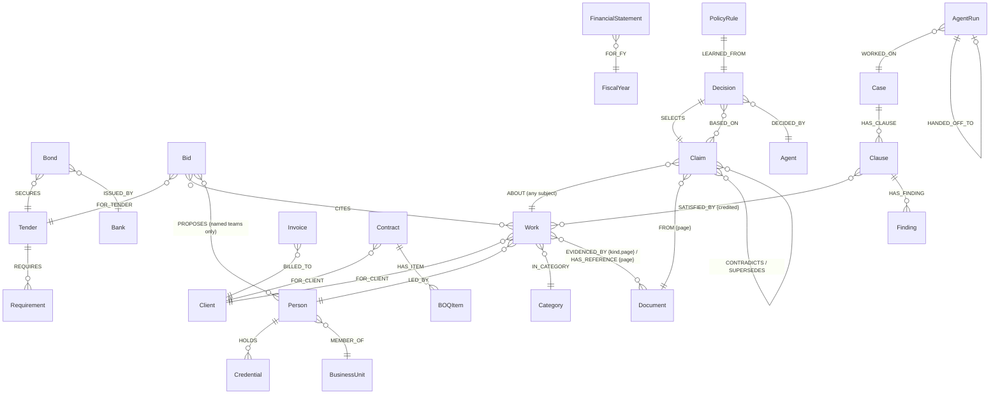

# BidBrain: the bid desk's company brain, on FalkorDB

> Infrastructure firms win public tenders by **proving** past performance: similar works of at least ₹X Cr for
> government clients, qualified key personnel, valid bank guarantees, turnover. The proof is spread across
> hundreds of certificates, letters, CVs, ledgers and audited statements, and those documents **contradict
> each other over time**.
>
> BidBrain puts a construction company's 687 documents into one FalkorDB graph. Agents use it to qualify
> tenders clause by clause, **prove absences**, settle conflicting documents as they arrive, ripple each change
> to every bid that relied on it, and show the path to the PDF page behind every answer.

**Headline result** (same Qwen3-32B, same FalkorDB, only the context strategy differs): BidBrain's graph tools score
**.810** on true-gold questions (S21), **.780** on absence questions (ABS) and **.896** on tender questions (TND). The
best of LLM text-to-Cypher, GraphRAG-SDK and vector RAG scores .333 / .537 / .542 on those sets. On 333 multi-hop
questions (Q333) BidBrain scores **.640** against .180 / .099 / .075, and on the 5-6-hop subset .52 against .14 / .14 / .10.

* **Q333 flatters us.** Its gold is our earlier engine's output, and our tools reproduce that engine (354/354). S21, ABS and TND gold is independent of the tools.
* **GraphRAG-SDK** ran with its automatic schema and no hand-written ontology.
* **Single runs** at temperature 0, on the pre-final code. 95% Wilson intervals are in the [table](#evaluation); S21 has only 21 questions.
* **The six-agent team's 144/144 on TND** came after fixing a parser bug found on that same set (136/144 before).
* **Cost:** BidBrain spends about 10× the tokens of text-to-Cypher per question (~13k vs ~1.3k).



**Live demo:** not deployed yet; run it locally with one `docker compose up` (below)  ·  **Video:** not recorded yet  ·  **Tracks:** Company Brain (lead) · Agents That Act on Connected Data · Agent Memory & Coordination

| What you'll see | Where |
|---|---|
| Paste a tender, and six agents produce a clause-by-clause verdict and a bid memo that cites certificate pages | **Qualify a tender** |
| "Which works have no reference letter?" The graph returns a *proof*; vector RAG can only reason about the letters it happened to retrieve | **Ask** → *Compare with vector RAG* |
| A corrigendum arrives, the conflict is settled by policy, and the open bid flips **BID → NO-BID** | **Live documents** |
| Every settled fact traced to its policy, decider, and both source documents; your decisions become learned rules | **Decisions** |
| Promote a learned rule to company memory, so other sessions' conflicts resolve by it, with provenance | **Live documents** → **Memory** |
| Bus factor (exact betweenness), isolated entities (WCC), client circles (label propagation), how two things connect (SPpaths), audit of past bids | **Explore** |
| Graph vs. vector RAG vs. text-to-Cypher vs. GraphRAG-SDK, same model, by hop count | **Benchmark** |

---

## Why this needs a graph

The questions a bid desk asks never live in one record:

* *"Starting from Sunita Joshi's Six Sigma certificate on the Pkg-107 ring road, what's the combined value of every
  work we completed for **that client**?"* That is person → credential → work → client → the client's whole portfolio
  → each certificate: **5 hops**, and the answer set is not the item the question names.
* *"How many of this client's works have **no** reference letter?"* A retriever reasons only over what it fetched, so
  it never sees the missing letter. Proving a negative requires knowing **the boundary of the set**, and the graph has it.
* *"A corrigendum just cut that work's value by 6%. **What breaks?**"* The answer is every open clause that relied on
  it, every past bid that cited it, and the tender it secured: a traversal from the changed fact outward.

## Architecture



* **One registry, three consumers.** The same 29 tool functions serve the in-app agents, the MCP server (28 of them, annotated read-only; `case_open` writes, so MCP leaves it out)
  (`/mcp/`, streamable HTTP; any MCP client can connect) and the evaluation oracle.
* **Arithmetic never happens in the LLM.** `aggregate` takes *work keys*, re-reads values from the graph, and computes
  in exact integer rupees.
* **Each visitor gets an isolated graph**: `GRAPH.COPY bidbrain_base session_<id>` on first visit, reaped after 24 h of
  inactivity. One judge resolving a conflict never changes what the next judge sees. A copy takes about 0.5 s and
  29.5 MB of Redis memory (measured), and at most 60 are live.
* **Company memory is opt-in.** A learned rule leaves its session only when someone promotes it to the shared
  `bidbrain_org` graph, with its provenance (who, when, and a copy of the decision it was learned from).

## Graph data model



| Layer | Nodes (count in base graph) | Purpose |
|---|---|---|
| Company records | `Work` 155 · `Client` 29 · `Person` 39 · `Credential` 48 · `Category` 13 · `Tender` 63 · `Requirement` 491 · `Bond` 60 · `Invoice` 518 · `Contract` 6 · `BOQItem` 43 · `Measurement` 407 · `FinancialStatement` 8 · `Asset` 210 · `Certification` 5 | the connected estate: every edge is a join the questions need |
| Provenance | `Document` 687 · `Chunk` 2,564 (fulltext + 384-d HNSW vector index) | every fact links to a document and page, so each answer cites the page |
| Claims | `Claim` 1,668 | every contestable value (work value, completion date, grading, role, experience, bond status, each statement line) with source, page, issuer, **authority**, date |
| Decisions | `Decision` (114 at boot) · `PolicyRule` · `ConflictCard` | how disagreements were settled, by whom, and why |
| Memory | `Bid` 6 (past bids from the dossiers) · `Case` · `Clause` · `Finding` · `AgentRun` · `Conversation` · `Turn` · `OrgRule` (in `bidbrain_org`) | episodic (past bids, conversations), shared multi-agent state (cases), procedural (learned rules, optionally promoted to company memory) |

Dates are also stored as integer `*_day` fields, so filters compare integers. Entity properties such as `Work.value`
are a **materialized view of the winning claim**: nothing is overwritten when a corrigendum arrives.

## The Cypher and algorithms BidBrain depends on

The full catalog is in **[docs/CYPHER.md](docs/CYPHER.md)**. It was generated by executing every tool and recording
the queries it actually ran. The core ones:

| Tool | What the graph does |
|---|---|
| `find_portfolio` | `MATCH (w:Work)-[:FOR_CLIENT]->(c:Client), (w)-[:LED_BY]->(p:Person), (w)-[e:EVIDENCED_BY {kind:'completion_certificate'}]->(d)` with client / person / **via-work hop** / category / value / date / govt-level filters |
| `prove_absence` | boundary `(c:Client)<-[:FOR_CLIENT]-(w)`, partition on `(w)-[:HAS_REFERENCE]->()`, then three checks: 3-view attestation, **corpus closure** (every letter is linked to some work), and a full-text orphan search |
| `qualify_clause` | CPWD 80/60/40% similar-works rule, turnover (conflict-aware), key personnel valid **on the bid date**, certifications, years in business from the CIN |
| `blast_radius` | `(subject)<-[:SATISFIED_BY]-(:Clause)<-[:HAS_CLAUSE]-(:Case)`, `<-[:CITES\|PROPOSES\|SECURED_BY]-(:Bid)` (a past bid cites only its Annexure D works in the tender's category), `-[:SECURES]->(:Tender)`, then re-runs the affected clauses and reports verdict flips |
| `key_people` | the bus factor as **exact** betweenness: Brandes in one Cypher query, `MATCH p = allShortestPaths((a)-[:WORKED_FOR*]-(b))` over every pair of the 68 people and clients (~0.1 s). `algo.betweenness` samples source nodes even with `samplingSize` above the node count, so it is reported beside it as a cross-check (32-seed mean: same top 3 in order, 4/5 of the top 5, 9/10 of the top 10) |
| `fact_history` | every competing `Claim` about a fact with its document and page, and the `Decision`s (policy, decider, learned rule) that settled it: the agent's answer to "why do we believe this?" |
| `explain_path` | `CALL algo.SPpaths({sourceNode, targetNode, relTypes, relDirection:'both', maxLen:6, pathCount:3})` |
| `isolated_entities` | `CALL algo.WCC(...)` over the evidence edges (`scope:'provenance'` or `'corpus'`): everything outside the main component is a finding, such as documents no fact cites, a client we invoice with no completed work, or staff with credentials who never led a work |
| `communities` | `CALL algo.labelPropagation(...)` over `OVERLAPS_CLIENTS` (two leads who share at least 1.5× the clients the configuration model expects): 3 client circles of 15 / 12 / 10 people, **modularity 0.203** against the full co-client graph (random splits of the same sizes: −0.021; a greedy optimiser: 0.21). `of:'clients'` gives the same circles from the client side (0.175; random −0.039) |
| `trace_from_credential` | the 5-hop credential → person → work → client → portfolio → certificate chain in one Cypher query |
| `depends_on` | provenance as a variable-length match, `MATCH p = (x)-[:FROM\|EVIDENCED_BY\|HAS_REFERENCE\|HOLDS\|BASED_ON\|SELECTS\|CITES\|...*1..4]->(:Document {doc_id:$doc})`: everything that rests on one document (claims, works, decisions, past bids, compliance rows, open clauses), and which facts it is the *only* source for |
| `compliance_check` | re-tests every MET row in the company's past compliance matrices (491 `Requirement` nodes) against the graph *on the date the claim was made*, using the `qualify_clause` rules: 318 checkable, 194 agree, 119 disagree. 105 of the 119 are most likely synthetic-generator artifacts, and the tool says so (`likely_generator_artifacts`): ISO certificates whose `initial_date` (2022) postdates the 2019-22 matrices citing them, one PMP issue date for every holder, and "210 owned assets" when the register holds 154 owned + 56 leased |
| `vector_search` / `fulltext_search` | `db.idx.vector.queryNodes('Chunk','embedding',k,vecf32($v))` / `db.idx.fulltext.queryNodes('Chunk',$q)` |
| `cypher_readonly` | the agent's escape hatch, executed as `GRAPH.RO_QUERY`, so the server rejects writes |
| tenancy | `GRAPH.COPY bidbrain_base session_<id>`; company rules live in a separate `bidbrain_org` graph |

## Agents

**Q&A agent.** A thin OpenAI-compatible tool loop over the read tools, with no agent framework. The prompt teaches how
to *use the graph* ("scope the client's portfolio, not the named work", "never do arithmetic") and leaves domain
knowledge to the tools. Two guards keep an answer consistent:

* **Unasked-filter guard.** Every narrowing filter the model sets on `find_portfolio`, `prove_absence` or
  `receivables` is checked for lexical support in what the user asked. An unsupported one gets a note in the tool
  result asking the model to call again without it.
* **One model per answer.** Later steps prefer the provider that served the first step, so one answer is not
  stitched together from several models. The pool still takes over on a rate limit.

Follow-ups recall older turns through the graph: when a question names a client, person or work that an earlier
turn `MENTIONS`, up to 3 of those turns are added before the last-6-turn window.

**Tender team: a planner, six agents, one case graph.**

| Agent | Uses LLM | Writes to the case graph |
|---|---|---|
| ClauseParser | yes (rule-based fallback) | `(:Clause {kind, params})` |
| Planner | no | the plan on the `Case` node: which agents run on which clauses, read from the clause kinds |
| EvidenceHunter | no | `(:Clause)-[:SATISFIED_BY {credited}]->(Work \| Person \| FinancialStatement \| …)`, verdicts |
| AbsenceAuditor | no | `(:Finding {kind:'absence'\|'expiry'\|'gap'})`: missing letters (with proof), PMPs lapsing before the bid, near misses |
| ConflictSentinel | no | findings for every relied-on fact with a contested or overturned claim, citing the Decision |
| **Verifier** | **no** | re-runs every clause against the graph; a disagreement sends the clause back to the EvidenceHunter once, and only if it persists is the case marked unverified and the recommendation **NEEDS REVIEW** |
| Assembler | yes (template fallback) | the bid memo: verdict per clause, an evidence table (document + page for every work, statement, person and certificate relied on), gaps, precedent past bids; downloadable as the bid pack |

Each agent is an `(:AgentRun)`, and handoffs are `(:AgentRun)-[:HANDED_OFF_TO]->(:AgentRun)`, in the order the
runs actually happened. **Hand-backs** go through the graph too. When the AbsenceAuditor finds that the works a
similar-works clause relies on have no reference letter, it leaves a request on the `Finding`. The EvidenceHunter
runs again and re-selects referenced works, keeping them only if the clause still passes. A second pass is a second
`AgentRun` with `pass_no`. The whole team runs in about 50 ms plus LLM time, and a rate limit can never stop a demo
because both LLM steps have deterministic fallbacks.

## Living knowledge: conflicts, decisions, ripple

```
new PDF ──► claims ──► same (subject, predicate), different value beyond the coarser source's precision?
                         └─► (a)-[:CONTRADICTS]->(b)
           policy:  1. a PolicyRule learned in this session matches    → auto (cites the rule)
                    2. a company rule promoted to bidbrain_org matches  → auto (cites the rule and its source decision)
                    3. the same issuer amended itself, at least as formally → auto (recency)
                    4. authority gap ≥ 20 on the ladder                 → auto (authority)
                    5. otherwise                                        → resolve card for a human
           every outcome ──► (:Decision)-[:SELECTS]->(winner), -[:BASED_ON]->(both), -[:DECIDED_BY]->(agent|user)
           then ──► blast_radius ──► verdict flips on open cases (BID → NO-BID)
```

Authority ladder: client corrigendum 95 · bank notice 95 · audited statement 95 · revised certificate 92 · client
certificate 90 · reference letter 80 · final bill 75 · JV partner certificate 75 · company record 70 · portfolio 60 ·
comparative column 50 · CV 40 · LLM-read prose 30.

The corpus contains **real** conflicts. Each audited statement's comparative "previous year" column disagrees with
that year's own statement on 114 fields. All 114 are auto-resolved at boot (own statement 95 beats comparative
column 50) and remain visible as Decisions. ₹193,299,999 on a certificate against ₹193,300,000 in the portfolio is
correctly treated as **rounding**, not a conflict.

Resolving a card with **"Choose + learn rule"** creates a `(:PolicyRule)-[:LEARNED_FROM]->(:Decision)`. The next
conflict of the same shape then resolves itself and cites your decision. **Promote to company memory** (Live
documents) copies the rule, with its provenance, into `bidbrain_org`; every session then applies it after its own
rules. Rules can be retired from the Memory page.

## Evaluation

All systems use **the same model (Qwen3-32B on vLLM)** and **the same FalkorDB instance**; only the context strategy
differs. The demo app runs on a pool of free Groq models instead (Groq no longer serves Qwen3-32B), so the benchmark
measures the strategies, not the deployed model.

| Gate / set | Result |
|---|---|
| **Tool sufficiency**: graph tools, given the deterministic engine's parsed parameters, reproduce its answers | **354 / 354**, and **21 / 21** on true gold |
| Hop-count formula vs the dataset's own `hops` labels | 21 / 21 agree |
| Conflict engine, JSON stream: 275 events, 200 conflicts + 75 hard negatives (rounding, unchanged restatements, unrelated fields) | P = R = F1 = **1.00**, routing 1.00, winner 1.00 |
| Conflict engine, **PDF path**: 50 rendered PDFs → extraction → entity resolution from varied titles → detection | F1 **1.00**, subject resolution 100%, value extraction 100% (first run: F1 0.976 and extraction 86.7%, which exposed 2 real bugs, both fixed) |

**Q&A accuracy** (Qwen3-32B on vLLM, temperature 0, exact match; full breakdown in `data/eval/qa_summary.json` and on
the Benchmark page):

| System | S21 (true gold, 21) | ABS (absence, 164) | TND (tender, 144) | Q333 (near-gold, 333) |
|---|---|---|---|---|
| **BidBrain agent** | **.810** [.600, .923] | **.780** [.711, .837] | **.896** [.835, .936] | **.640** [.587, .689] |
| LLM text-to-Cypher | .333 [.172, .546] | .537 [.460, .611] | .264 [.199, .341] | .180 [.143, .225] |
| GraphRAG-SDK (auto schema, all 678 docs) | .190 [.077, .400] | .311 [.245, .385] | .542 [.460, .621] | .099 [.071, .136] |
| Vector RAG | .190 [.077, .400] | .268 [.206, .341] | .389 [.313, .470] | .075 [.051, .108] |
| Constant answer (always 0 / majority) | .190 | .427 | .472 | .045 |

Brackets are 95% Wilson intervals (`accuracy_ci95`). **These runs used the pre-final code** (summary generated
17 Oct 07:33). They predate the Planner, the hand-backs, the unasked-filter guard and the newest tools, and will be
re-run on the final code.

By hop count on Q333 (2-3 / 4 / 5-6 hops): BidBrain .92 / .72 / .52, text-to-Cypher .32 / .18 / .14, GraphRAG-SDK
.00 / .07 / .14, vector RAG .00 / .06 / .10. The graph's advantage grows with the number of joins. Cost per Q333 question: BidBrain 3.9 LLM calls,
~13k tokens, p50 4.2 s; text-to-Cypher 2.2 calls, ~1.3k tokens, 2.5 s; vector RAG 1 call, ~3.5k tokens, 5.3 s; GraphRAG-SDK p50 15.2 s.
GraphRAG-SDK ingested every document with its own LLM entity extractor on the same model (its default local
GLiNER extractor needed ~6 GB of RAM per run on our machine); 6 chunk-level relation steps hit the 32k context.

Honest notes:

* **Six-agent team on TND: 144/144 (95% CI .97–1.0), 0 LLM calls.** This measures the deterministic graph
  pipeline (rule clause parser → EvidenceHunter → AbsenceAuditor → ConflictSentinel → Verifier), not an LLM. Its
  first run scored 136/144; all 8 misses were one parser bug ("buildings" also matched "small buildings"), which we
  fixed after seeing them, so treat this number as tuned on the test set. Four of the six agents are deterministic
  graph agents; only ClauseParser and Assembler use an LLM.
* S21 (n=21) is too small to rank systems on its own. BidBrain spends ~10× the tokens of text-to-Cypher per
  question. JV works are credited at full value (the corpus has no share %), and there is no bank-guarantee clause.
* **Two BidBrain runs.** In the first run, BidBrain scored .313 on TND. The agent's one-line tool description for
  `qualify_clause` named no parameters, so the model invented keys (`thresholds`, `min_experience`) that the tool
  silently ignored. We then documented and validated the parameters. This fix applies to every question; nothing was
  tuned to individual questions. We re-ran BidBrain on every set: TND went to .896, and Q333 moved from .646 to .640.
  The first run is kept in `data/eval/results/run1/`. The baselines do not use these tools, so they were not re-run.
* These are single runs. Between the two BidBrain runs, 19 Q333 answers went right→wrong and 17 wrong→right
  (net .646 → .640), so per-question noise is larger than the net change suggests.
* Constant answers are included because they are informative. On ABS, always answering 0 (.427) beats vector RAG
  and GraphRAG-SDK; vector RAG gave a wrong count on 80 of the 164 questions and no number on 40. On TND, the
  majority verdict (.472) beats text-to-Cypher and vector RAG.
* GraphRAG-SDK chose its own schema; we gave it no hand-written ontology, which would likely raise its score.
* Q333 gold is the old deterministic engine's output, which scored 99.775 on the hidden leaderboard, so it is
  *near*-gold. Our tools reproduce that engine (354/354), so Q333 flatters BidBrain. True-gold results (S21) are
  reported separately.
* The conflict rules and the planted labels were written by the same team, so the JSON path mostly checks
  consistency. The PDF path adds parts that can genuinely fail, and its first-run numbers are reported too.
* ABS and TND gold comes from independent Cypher and a separate re-implementation of the rules
  (`eval/synth.py`), not from BidBrain's tools.

## Run it

```bash
cp .env.example .env          # optional: GROQ_API_KEY / CEREBRAS_API_KEY for free-text Q&A
docker compose up --build     # http://localhost:7860  (UI + API + MCP at /mcp)
```

Without any LLM key everything still runs except free-text Q&A: tender qualification, live documents,
decisions, exploration and the benchmark page.

**Development**

```bash
docker run -d -p 6379:6379 falkordb/falkordb:latest
cd backend && uv venv --python 3.12 .venv && uv pip install -r requirements.txt && source .venv/bin/activate
# the corpus is not vendored; fetch the pinned commit the facts were extracted from
git clone https://github.com/satvikGIKA/BITS-Hackathon-Dataset vendor_bidintel/dataset
git -C vendor_bidintel/dataset checkout 707c80fc7a57dad0c0f58cb4b305f4ecfba27c8a
python -m bidbrain.ingest.load_graph          # builds bidbrain_base (~2 s)
uvicorn bidbrain.api.main:app --port 7860     # keep running; open a second terminal for the UI
```

```bash
cd frontend && npm ci && NEXT_PUBLIC_API_BASE=http://localhost:7860 npm run dev
```

**Connect an MCP client** (Claude Desktop, etc.): point it at `/mcp/` on the live demo URL above (streamable HTTP), or run
`python -m bidbrain.mcp.server` for stdio. All read-only graph tools are exposed against the pristine base graph.

**Reproduce the evaluation**

```bash
python -m eval.oracle                       # tool sufficiency gate (354/354)
python -m eval.conflict_pr                  # planted conflict stream, JSON path
python -m eval.conflict_pdf --per-type 5    # render → extract → resolve → detect
python -m eval.synth                        # ABS + TND sets with independent gold
LLM_PROVIDERS=vllm python -m eval.run --system bidbrain --set Q333   # Qwen3-32B on vLLM
python -m eval.run --summarize
```

## Repository

```
backend/bidbrain/ingest     graph loader, claims, page provenance, aliases, past-bid dossiers, chunks+embeddings
backend/bidbrain/tools      the 29 graph tools (one registry → agents, MCP, eval)
backend/bidbrain/conflicts  conflict engine, planted events, PDF rendering + live ingestion, demo scenarios
backend/bidbrain/agents     provider failover + cache, tool loop, Q&A agent, tender team, baselines
backend/bidbrain/api        FastAPI + SSE, per-session graphs, conversation memory
backend/bidbrain/mcp        MCP server (stdio + streamable HTTP)
backend/eval                oracle, conflict P/R (JSON + PDF), synthesized sets, benchmark runner
backend/vendor_bidintel     reused extraction layer (credited below); not FalkorDB code
frontend/                   Next.js (static export) + react-force-graph
infra/                      container entrypoint, Sharanga vLLM job
docs/                       CYPHER.md · EXPLAINER.md · DEMO_SCRIPT.md · BLOG.md
```

## Credits, data and AI disclosure

* **Data**: the synthetic construction-company corpus from the BITS Hackathon "Bid Intelligence" challenge,
  [satvikGIKA/BITS-Hackathon-Dataset](https://github.com/satvikGIKA/BITS-Hackathon-Dataset) (MIT). It is fully synthetic;
  no real company or person.
* **Reused code**: `backend/vendor_bidintel/` is the PDF/xlsx extraction layer our team members (Shoyam Mishra,
  Atharv Gaur) wrote for that earlier hackathon, kept unchanged and credited. It produces `facts.json` and contains
  no FalkorDB code. Everything under `backend/bidbrain/`, `backend/eval/` and `frontend/` (graph model, Cypher,
  agents, conflict engine, MCP, UI, evaluation) is new work for Graph Hacks.
* **AI usage**: this project was built with substantial help from AI coding assistants (Claude Code) for code
  generation, refactoring and documentation, under the team's direction and review. The architecture, data model and
  evaluation design are explained in [docs/EXPLAINER.md](docs/EXPLAINER.md).
* **Built on** FalkorDB (graph, vector and full-text indexes, `algo.*`, `GRAPH.COPY`), FastAPI, the MCP Python SDK,
  fastembed (bge-small-en-v1.5), Next.js and react-force-graph. LLMs: a pool of free Groq models for the demo
  (openai/gpt-oss-120b, qwen/qwen3.8-27b, openai/gpt-oss-20b) and Qwen3-32B on vLLM for the evaluation.
