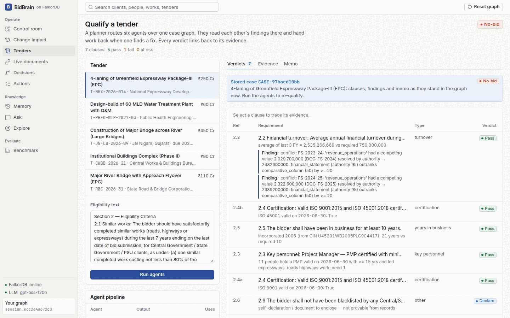
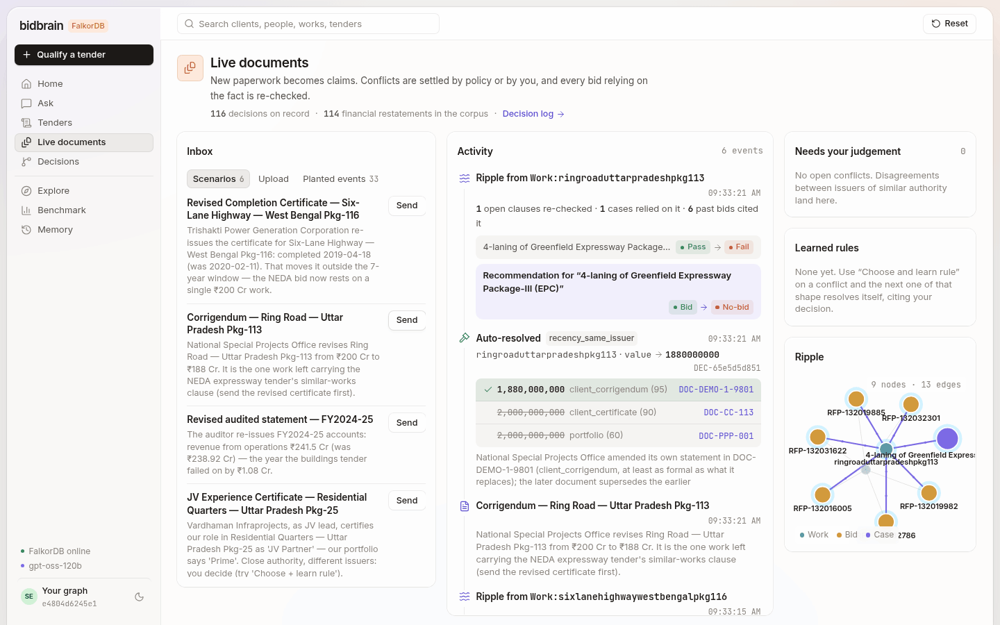
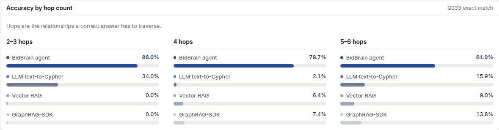
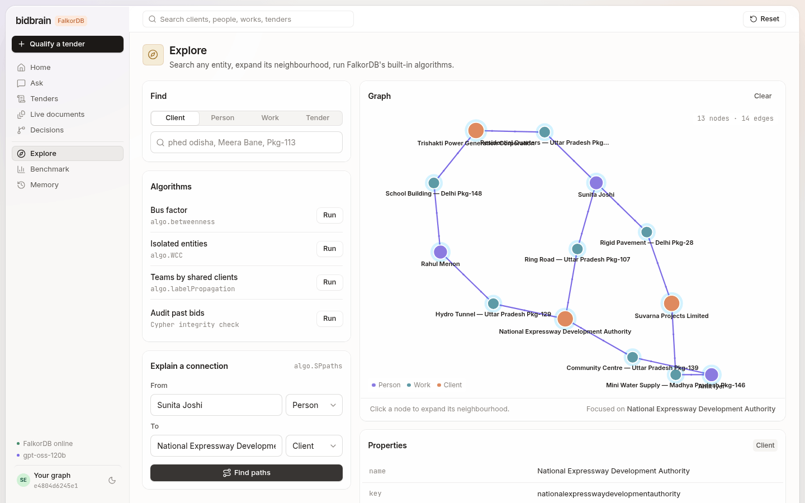

# Proving what isn't there: building a company brain on FalkorDB

*How we built BidBrain for Graph Hacks: a company brain that turns changing evidence into auditable business
decisions and coordinated actions, with a construction bid desk as the proving ground.*

> **TL;DR**
> * BidBrain loads a construction company's 687 documents into one FalkorDB graph. When a new document arrives, the graph settles which fact wins (by policy, or by a person), walks from that fact to every open bid that relied on it, re-qualifies those bids without an LLM, and opens **accountable actions**: a person approves, deterministic code executes, and every step is audited. A fact the bid manager publishes becomes part of the **company record**, and every new workspace starts from it.
> * A deterministic workflow evaluation runs that whole loop with the LLM disabled: **79/79** checks, and the bids it reports as flipped match an independent before/after recompute with precision and recall 1.0.
> * On answer accuracy (same model, same database, four context strategies), graph tools score **.762** on independent-gold questions, **.835** on absence questions and **.931** on tender questions in the headline run (a second run: .810 / .884 / .924); the best baseline on each set scores .333, .500 and .542. Final code, two runs each.
> * The FalkorDB parts are below as copy-paste recipes: an absence proof, exact betweenness in one Cypher query, a full-text gotcha, `algo.SPpaths`, `GRAPH.COPY` tenancy, WCC as an evidence check, label propagation that beats a random split, a claim → decision → policy-rule schema, and an action layer that turns a recommendation into accountable state.
> * Caveats sit next to the results, not at the end: real run-to-run variance (S21 moved 2 of 21 between runs), two regressions found and fixed on S21 before the final runs, one near-gold set whose gold our tools mirror, a team score tuned on its test set, and GraphRAG-SDK run without a domain ontology.

---

## The question that breaks retrieval

A bid manager at an Indian construction firm asks this every week:

> *"Which of Trishakti Power Generation Corporation's completed works have no client reference letter on file?"*

A retrieval-augmented LLM cannot answer it reliably. The retriever fetches the eight chunks most similar to the
question. Those are reference letters, because the question mentions them. A letter that was never written has no
chunk, so it can never be retrieved. The model can only count what it was handed, or give up. On our 164 absence
questions, vector RAG gave a wrong count 80 times and no number 40 times. On this exact question it answered 8. The
right answer is 2.

Answering properly needs **the boundary of the set**: every work this client certified, attested independently,
plus proof that every letter in the estate is accounted for. That is a graph question. Here is what BidBrain's
`prove_absence` tool returns for it, verbatim (no LLM involved):

```json
{"claim": "2 of 19 works in scope have no reference letter on file",
 "verdict": "PROVEN", "universe": 19, "present": 17, "absent_count": 2,
 "absent": [{"key": "robuttarpradeshpkg85",      "title": "ROB — Uttar Pradesh Pkg-85",      "orphan_search_hits": []},
            {"key": "flyoveruttarpradeshpkg43", "title": "Flyover — Uttar Pradesh Pkg-43", "orphan_search_hits": []}],
 "checks": {"boundary_attested_by_3_views": "19/19",
            "corpus_closure": "132/132 letters linked",
            "orphan_search": "no unlinked letter mentions a missing work"}}
```

The rest of this post covers how we got there, and then gives you the Cypher.

## The problem: proof is scattered, and it contradicts itself

Indian public tenders are won on eligibility before price. The CPWD "similar works" rule is typical: in the last
seven years, **one** completed government work worth at least 80% of the estimated cost, **or two** at 60%, **or
three** at 40%, each backed by the client's completion certificate.

Our data is a synthetic company: 687 documents, including 155 completion certificates from 28 clients and 132
reference letters. **Nothing says which document belongs to which project**, so a typical question walks person →
credential → work → client → *that client's whole portfolio* → each certificate's value. Five hops.

The documents also disagree. Each audited statement's "previous year" column contradicts the previous year's own
statement on 114 fields. FY 2024-25 revenue is ₹238.92 Cr in one and ₹232.26 Cr in the other, so a "₹240 Cr in each
of the last three years" clause fails by ₹1.08 Cr or by ₹7.74 Cr, depending on which document you trust.

## Claims, not overwrites

The most important modelling decision was to stop treating property values as facts. Every contestable value is a
**claim node**:

```cypher
(:Claim {predicate:'value', value:2000000000, source_doc:'DOC-CC-113', page:1,
         issuer:'National Special Projects Office', source_kind:'client_certificate',
         authority:90, observed_day:20543})-[:ABOUT]->(:Work)
```

`Work.value` is a **materialized view of the winning claim**. When a corrigendum arrives we add a claim, link the
disagreement with `CONTRADICTS`, and settle it with a `(:Decision)` that records the policy, the rationale, the
decider and both documents. History is never edited: the losing claim keeps its value and gets `invalidated_at`,
next to the `recorded_at` every claim carries, so `fact_as_of` can answer "what did we believe on date T". The policy
is deliberately boring:

1. a fact already published to the **company record** (approved in another workspace; it cites its origin);
2. a rule a human taught this session;
3. a rule someone promoted to **company memory** (opt-in, with provenance);
4. the same issuer amending itself **with a document at least as formal** (a client's chatty letter must not
   silently override its own certificate);
5. a clear authority gap (client corrigendum 95, certificate 90 … CV 40);
6. otherwise, ask a human.

The schema is reusable outside tenders, so it gets its own recipe at the end.

## Agents that hand off through the graph

Six agents qualify a tender, coordinated by a planner:

1. read the eligibility text into typed clauses;
2. qualify each clause by traversal;
3. prove absences (missing letters, credentials lapsing before the bid date);
4. check the conflict history of every fact the verdict relies on;
5. **re-derive every verdict with no LLM at all**;
6. write the bid memo.

They share no framework memory. Each agent is an `(:AgentRun)` that writes `Clause`, `SATISFIED_BY` and `Finding`
nodes, and the next agent reads them (`HANDED_OFF_TO`). Four of the six are deterministic graph code. Only the
clause parser and the memo writer use an LLM, and both have rule-based fallbacks. The whole team takes about 50 ms
plus LLM time.

The pipeline is not a fixed line. A **Planner** (no LLM) reads the clause kinds and stores on the `Case` node which
agents run on which clauses, and every agent reads its assignment from there. Agents can also hand work back
through the graph. If the AbsenceAuditor finds that the works a clause relies on have no reference letter, it
leaves a request on that `Finding`. The EvidenceHunter then runs again and re-selects referenced works, keeping
the new selection only if the clause still passes. If the Verifier disagrees with a verdict, the EvidenceHunter
re-derives that clause once. The case is marked NEEDS REVIEW only if they still disagree.



Because verdicts are edges to the facts they rely on, **a change can find everything it breaks**. A corrigendum cuts
the Pkg-113 ring road from ₹200 Cr to ₹188 Cr. `blast_radius` walks outward from that work and finds the open clauses
that rely on it, the past bids that cited it, and the tenders it secured. It then re-runs the affected clauses. The
expressway bid flips **from BID to NO-BID**, and the reason is one click away.


The Change impact page reads that whole chain back from the graph for any document (`change_impact`): document →
claim → decision → ripple finding → clause → case → action. The Live documents page is where documents are sent and
close calls are decided:



## Tools, not text-to-Cypher

The registry has 31 named tools, and the Q&A agent is offered 23 of them. Raw Cypher is not the interface.
`find_portfolio` (with a `via_work` hop), `prove_absence`, `qualify_clause` and `explain_path` are each a tested
traversal that returns evidence (document and page) and a subgraph for the UI. **Arithmetic never happens in the
model.** `aggregate` takes *work keys*, re-reads values from the graph and computes in exact integer rupees.

The same registry serves our agents, any **MCP** client (`/mcp`, 30 read-only tools plus one acting tool, `qualify_tender`, which runs the tender team on a session's own graph copy), and an evaluation **oracle**.
The oracle replays a deterministic engine's parsed parameters through our tools and reproduces **354 of 354**
reference answers. So any accuracy the LLM agent loses comes from planning, not from missing graph capability.

## Did the graph do the work?

Same model (Qwen3-32B on vLLM, temperature 0), same FalkorDB instance, four context strategies: BidBrain's tools,
LLM text-to-Cypher, vector RAG over FalkorDB's own vector index, and FalkorDB's GraphRAG-SDK. Exact-match accuracy
with Wilson 95% intervals, from `data/eval/qa_summary.json`: final code, two runs per system with fresh LLM caches
(GraphRAG-SDK: one earlier run). The benchmark model (Qwen3-32B on vLLM) is not the demo model (a pool of Groq models).

| System | S21, independent gold (n=21) | ABS, absence (n=164) | TND, tender (n=144) | Q333, engine-derived near-gold (n=333) |
|---|---|---|---|---|
| **BidBrain (graph tools)**, run 1 | **.762** [.549, .894] | **.835** [.771, .884] | **.931** [.877, .962] | **.703** [.652, .749] |
| BidBrain, run 2 · mean of both | .810 · .786 | .884 · .860 | .924 · .927 | .703 · .703 |
| LLM text-to-Cypher, run 1 · mean | .333 · .381 | .500 · .491 | .361 · .385 | .147 · .150 |
| GraphRAG-SDK (auto schema; one run) | .190 [.077, .400] | .311 [.245, .385] | .542 [.460, .621] | .099 [.071, .136] |
| Vector RAG, run 1 · mean | .238 · .238 | .268 · .265 | .403 · .399 | .069 · .068 |
| Constant answer (always 0 / majority) | .190 | .427 | .472 | .045 |

**Read these caveats with the table:**

* **Q333's gold is the engine our tools mirror.** It is the output of our earlier deterministic engine, and the tool
  oracle reproduces it 354/354. Q333 therefore flatters BidBrain. Judge us on S21 (independent gold) and on ABS and TND,
  whose gold comes from independent Cypher and a separate re-implementation of the rules (`eval/synth.py`).
* **GraphRAG-SDK ran without an ontology.** We used its automatic schema extraction and gave it no hand-written
  ontology. A domain ontology would very likely score higher, so read its row as "generic GraphRAG", not as a ceiling.
* **Two runs, and real variance.** At temperature 0, BidBrain moved 2 of 21 questions on S21 (.762 vs .810) and 8 of
  164 on ABS between two runs. S21 has only 21 questions: treat it as a sanity check and read the mean.
* **Two regressions were found on S21 before the final runs.** A first final run scored S21 .714. Its misses showed
  the agent misusing a tool we had just offered it (`trace_from_credential`, now MCP-only) and the filter guard
  ignoring amounts in words ("six crore"). We fixed both, then ran twice. The fixes are general, but S21 is no longer
  a clean held-out set for them; that run is kept in `data/eval/results/final_v1/`.
* **An earlier fix, too.** A pre-final run scored .313 on TND because `qualify_clause`'s one-line description named
  no parameters; documenting them is what took TND to .9. That run is in `data/eval/results/run1/`.
* **Constant answers are informative.** Always answering 0 beats vector RAG and GraphRAG-SDK on ABS. The majority
  verdict beats text-to-Cypher and vector RAG on TND.
* **Cost.** BidBrain spends about 18k tokens per Q333 question (4.1 LLM calls, p50 5.5 s). Text-to-Cypher spends
  about 1.4k tokens (2.7 s), roughly a twelfth.



**The company loop is scored separately, without an LLM.** `eval/workflow.py` drives the real API on throwaway
graphs with `providers.chat` raising, and takes every expectation from the fixtures, separate Cypher or a re-run of
`qualify_clause` on a graph copy, never from the function under test:

| Dimension | Passed | What is checked |
|---|---:|---|
| task completion | 15/15 | corrigendum → review action → approve → execute; letter and renewal requests; rejected actions never run; idempotent execute and creation |
| impact recall | 18/18 | flips reported by `/api/impact` vs an independent before/after re-run of every open clause over 9 events: P = R = 1.0 (4 flips, 198 clause re-checks) |
| adversarial conflicts | 16/16 | rounding, unrelated corrigenda, a later but less formal letter, close authority, expired credentials, absence PROVEN vs UNPROVEN, aliases |
| memory transfer | 9/9 | promoted rules apply only after opt-in; a published fact applies in new and existing workspaces, citing its origin |
| isolation | 9/9 | workspace B sees nothing of A; A's ids are 404 from B |
| temporal | 4/4 | `fact_as_of` just before and after the corrigendum |
| provenance | 8/8 | every evidence row names a real document and page; every decision selects one of its sources |

The first run scored 78/79: renewal actions were created for every PMP holder whose credential was lapsing, not just
the people the clause relied on. That was a real product bug, and it is fixed. The same team wrote the fixtures and
the code, so this shows consistency on designed scenarios, not generalisation.

The gap widens with the number of joins. GraphRAG-SDK built an 8,781-node graph from the 678 PDFs, but it infers
its schema one chunk at a time. Nothing in that graph knows that a certificate's value and a portfolio's value are
the same fact, or what "the client behind Pkg-113" means. That knowledge is the data model, and the data model is
what a domain graph buys you.

## FalkorDB recipes

Everything below is taken from the repo (`backend/bidbrain/`) and runs on stock `falkordb/falkordb:latest`.

### 1. Prove an absence: boundary, partition, closure, orphan search

A count of zero proves nothing unless you also show that the set was complete and that nothing was missed while
linking documents. `prove_absence` (`tools/proof.py`) runs four queries. The boundary query below is trimmed from
`find_portfolio`, which adds person, category, value and date filters.

```cypher
// 1. Boundary: every work this client certified
MATCH (w:Work)-[:FOR_CLIENT]->(c:Client {key:$client}),
      (w)-[:EVIDENCED_BY {kind:'completion_certificate'}]->(:Document)
RETURN collect(w.key) AS keys

// 2. Partition: which of them have a reference letter (w.views lists the independent sources that attest the work)
MATCH (w:Work) WHERE w.key IN $keys
OPTIONAL MATCH (w)-[h:HAS_REFERENCE]->(r:Document)
RETURN w.key AS key, w.title AS title, w.views AS views,
       collect({doc: r.doc_id, page: h.page}) AS refs

// 3. Corpus closure: every letter in the estate is linked to some work,
//    so a missing link cannot be a letter we failed to match
MATCH (d:Document {doc_type:'reference_letter'})
OPTIONAL MATCH (w:Work)-[:HAS_REFERENCE]->(d)
RETURN count(d) AS letters, sum(CASE WHEN w IS NULL THEN 1 ELSE 0 END) AS unlinked

// 4. Orphan search: full-text for each missing title over reference-letter text only
CALL db.idx.fulltext.queryNodes('Chunk', $q) YIELD node
WITH node WHERE node.doc_id STARTS WITH 'DOC-REF-'
RETURN collect(DISTINCT node.doc_id) AS hits
```

The verdict is `PROVEN` only if `unlinked = 0`, every work in the boundary has all three views, and every orphan
search comes back empty. Otherwise the tool says `UNPROVEN` instead of guessing. The credential and bond variants
use the same pattern with their own closure checks: every credential has a holder and a date, and every bond
secures a tender.

### 2. Betweenness needs an undirected projection

Our domain edges point `(:Work)-[:LED_BY]->(:Person)` and `(:Work)-[:FOR_CLIENT]->(:Client)`. In that directed
graph, no shortest path passes *through* a person. We ran `algo.betweenness` over `LED_BY`/`FOR_CLIENT`, and every
one of the 39 people scored exactly 0. The fix is an explicit person⇄client projection, built at load time
(`ingest/load_graph.py`):

```cypher
MATCH (p:Person)<-[:LED_BY]-(w:Work)-[:FOR_CLIENT]->(c:Client)
WITH p, c, count(w) AS n, sum(w.value) AS v
CREATE (p)-[:WORKED_FOR {works:n, value:v}]->(c), (c)-[:ENGAGED {works:n, value:v}]->(p)
```

```cypher
CALL algo.betweenness({nodeLabels:['Person','Client'], relationshipTypes:['WORKED_FOR','ENGAGED'],
                       samplingSize:100000, samplingSeed:$seed})
YIELD node, score WITH node AS p, score WHERE p:Person RETURN p.key AS key, score
```

There is a second trap. `algo.betweenness` samples source nodes even when `samplingSize` is larger than the graph,
so below the top two, one call's ranking depends on the seed. Averaging 32 seeded runs was not enough either: ranks
4-6 still differed from exact Brandes. On a 68-node projection you can afford the exact answer, in one Cypher query:

```cypher
MATCH (a) WHERE (a:Person OR a:Client) AND (a)-[:WORKED_FOR]-()
WITH collect(a) AS ns
UNWIND ns AS a UNWIND ns AS b
WITH a, b WHERE id(a) < id(b)
MATCH p = allShortestPaths((a)-[:WORKED_FOR*]-(b))
WITH a, b, collect(nodes(p)[1..-1]) AS inner              // every shortest path of this pair, endpoints dropped
WITH inner, toFloat(size(inner)) AS n
UNWIND inner AS path_inner UNWIND path_inner AS v
WITH v, sum(1 / n) AS score WHERE v:Person                  // each inner node gets 1/n of the pair
RETURN v.key AS key, score
```

That is Brandes' definition, computed by the database over 2,278 pairs in about 0.1 s, and it matches a Python
Brandes implementation to the decimal. `key_people` (`tools/algos.py`) ranks by it and still runs the sampled
`algo.betweenness` (32 seeds) as a reported cross-check: same top 3 in order, 9 of the top 10.

### 3. Full-text: index a whitespace-folded copy

The full-text index does not split tokens on newlines. Our page chunks kept the PDF line breaks, so
`Work\nAnganwadi` was indexed as one token. About 60% of keyword hits silently disappeared. (We reproduced this on
a throwaway graph: a search for `Anganwadi` finds 0 nodes on the raw text and 1 on the folded copy.) Keep the raw text
for display and index a folded copy (`ingest/chunks.py`):

```python
def _ft(text: str) -> str:
    """Whitespace folded, curly quotes and dashes turned into spaces."""
    return " ".join(re.sub(r"[‘’‚“”„–—―…«»]", " ", text).split())

g.run("""UNWIND $rows AS r MATCH (d:Document {doc_id:r.doc_id})
         CREATE (c:Chunk {key:r.id, doc_id:r.doc_id, page:r.page, text:r.text, ft:r.ft,
                          embedding: vecf32(r.emb)})
         CREATE (c)-[:PART_OF]->(d)""", {"rows": rows})
g.run("CALL db.idx.fulltext.createNodeIndex('Chunk', 'ft')")
```

To check your own index, compare `db.idx.fulltext.queryNodes` hit counts with a `WHERE n.text CONTAINS $word` scan
on a few words.

### 4. "How are these connected?": `algo.SPpaths`, not `shortestPath`

Cypher's `shortestPath` is the obvious first try, but FalkorDB rejects both of the forms you would reach for:

```
MATCH p = shortestPath((a)-[*]-(b)) ...   -> FalkorDB currently only supports shortestPaths in WITH or RETURN clauses
RETURN shortestPath((a)-[*]-(b))          -> FalkorDB does not currently support undirected shortestPath traversals
```

`algo.SPpaths` takes a direction, a hop limit and a path count (`explain_path` in `tools/algos.py`):

```cypher
MATCH (a:Person {key:$a}), (b:Client {key:$b})
CALL algo.SPpaths({sourceNode:a, targetNode:b,
                   relTypes:['LED_BY','FOR_CLIENT','HOLDS','SECURES','REQUIRES','HAS_REFERENCE'],
                   relDirection:'both', maxLen:6, pathCount:3})
YIELD path, pathWeight
RETURN [n IN nodes(path) | coalesce(n.name, n.title, n.key)] AS nodes,
       [r IN relationships(path) | type(r)] AS rels, pathWeight AS hops
ORDER BY hops
```



### 5. `GRAPH.COPY` as a tenancy model

Every visitor to the demo gets a private copy of the company graph on their first request. One judge resolving a
conflict never changes what the next judge sees. The session id lives in the browser, so a returning visitor gets
back their own cases, decisions and learned rules (`api/sessions.py`, trimmed):

```python
def graph_for(sid: str) -> Graph:
    name = f"session_{sid}"
    with _lock:
        live = db().list_graphs()
        if name not in live:
            _evict_if_full(live)                                     # at most 60 live; oldest idle copy goes
            db().connection.execute_command("GRAPH.COPY", "bidbrain_base", name)
        _last_seen[name] = time.time()                               # a reaper drops copies idle for 24 h
    return Graph(name)
```

**What it costs.** We measured three copies of our base graph (7,544 nodes and 12,839 edges at the time). Each took about 0.5 s, including the
first query, and added **29.5 MB** of Redis memory. `GRAPH.MEMORY USAGE` reports 16 MB for the graph and 3 MB for
its indexes. 9 MB of the graph is page chunks with their 384-d embeddings, which no visitor ever edits. At our cap of
60 sessions, that is about 1.8 GB. If we did it again, we would keep the chunks and vectors in one shared read-only
graph and copy only the part people can change.

### 6. Evidence integrity, a compliance audit, and communities that beat chance

Three more uses of the graph, each one call:

**WCC as an evidence check.** `algo.WCC` over evidence edges only (`EVIDENCED_BY`, `HAS_REFERENCE`, `FOR_CLIENT`,
`LED_BY`, `HOLDS`) should return one component: every fact connected to a document. Everything outside it is a
finding. On our corpus scope it found 404 workbook rows (210 assets, 194 trial-balance lines) with no path to any
document, which we then linked to their spreadsheets at load, plus 8 bank statements and 6 RA bills nothing cites, and
two credentialed staff who never led a work. Leave the hub edges out (`Company-OWNS`, `IN_STATE`, `FOR_FY`): they join
everything and hide the orphans.

```cypher
CALL algo.WCC({nodeLabels:['Document','Work','Client','Person','Credential'],
               relationshipTypes:['EVIDENCED_BY','HAS_REFERENCE','FOR_CLIENT','LED_BY','HOLDS']})
YIELD node, componentId
WITH componentId, labels(node)[0] AS label, count(*) AS n
RETURN componentId, collect({label: label, n: n}) AS parts ORDER BY componentId
```

**Auditing our own past claims.** The corpus has 40 compliance matrices with 491 `Requirement` rows, every one
marked MET. `compliance_check` re-tests each row the engine can evaluate *on the date the matrix was submitted*, with
the same rules the bid team uses: 318 checkable, 194 agree, 119 disagree. Be careful what you conclude from that.
105 of the 119 follow three patterns that most likely come from the synthetic generator, and the tool labels them
`likely_generator_artifacts`: all 52 ISO disagreements are 2019-22 matrices citing certificates whose `initial_date`
is 2022; all 13 PMP ones predate the single issue date every PMP on file shares; all 40 plant ones state "210 owned
assets", which is the whole register, 154 owned plus 56 leased. That the audit surfaces generator defects is a fair
test of it, but it is not evidence the company lied.

**Communities that beat a random split.** `algo.labelPropagation` takes no edge weights: it rejects any weight key,
and parallel edges do not change its answer. So put the weight into the projection. We link two project leads only
when they share more clients than the configuration model, modularity's own null model, predicts:

```cypher
MATCH (p:Person)-[:WORKED_FOR]->(c:Client)
WITH p, sum(size([(c)<-[:WORKED_FOR]-(x:Person) | x]) - 1) AS d          // weighted degree in the co-client graph
WITH collect({p: p, d: d}) AS deg, sum(d) AS two_m
UNWIND deg AS x
MATCH (a:Person)-[:WORKED_FOR]->(c:Client)<-[:WORKED_FOR]-(b:Person) WHERE a = x.p AND id(a) < id(b)
WITH a, b, x.d AS da, count(c) AS shared, deg, two_m
WITH a, b, shared, da * [y IN deg WHERE y.p = b][0].d / toFloat(two_m) AS expected
WHERE shared >= 1.5 * expected
CREATE (a)-[:OVERLAPS_CLIENTS {shared: shared, expected: expected}]->(b),
       (b)-[:OVERLAPS_CLIENTS {shared: shared, expected: expected}]->(a)
```

Label propagation over it finds 3 client circles (15, 12 and 10 people, plus 2 singletons). Scored against the full
co-client graph:

| Partition | Modularity |
|---|---|
| ≥ 2 shared clients (the first try) | −0.007 (one block of 31) |
| ≥ 2 shared and Jaccard ≥ 0.25 (round 1) | 0.107 |
| **shared ≥ 1.5 × expected** | **0.203** |
| greedy local-move optimiser (reference, Python) | 0.21 |
| random partitions with the same sizes (mean of 200) | −0.021 |

The split is the same for any factor from 1.2 to 1.6. For clients, label propagation on client-client projections
(shared leads, with or without a Jaccard filter) either merged everything or shattered it, never above 0.14. Placing
each client in the people circle that holds most of its leads scores 0.175 (random −0.039, greedy 0.18), and gives
the same circles seen from both sides. `communities` returns the modularity and the random baseline with every answer.

**Everything that rests on one document.** Every dependency edge points from the thing that relies to the thing
relied on, so provenance is one variable-length match into the document:

```cypher
MATCH (d:Document {doc_id:$doc})
MATCH p = (x)-[:FROM|EVIDENCED_BY|HAS_REFERENCE|HOLDS|BASED_ON|SELECTS|CITES|SECURED_BY|CITES_CERT|SATISFIED_BY|HAS_FINDING|HAS_CLAUSE*1..4]->(d)
WHERE NOT x:Document
WITH x, p ORDER BY length(p)
WITH x, collect(p)[0] AS p
RETURN labels(x)[0] AS label, length(p) AS depth, [r IN relationships(p) | type(r)] AS via
```

For the ISO 9001 certificate, that is the certificate and its claim at depth 1 and 21 compliance rows at depth 2;
`depends_on` also lists which direct facts the document is the *only* source for.

## Steal this pattern: claim → decision → policy rule

Any company brain ingests documents that disagree: price lists, contracts, HR records, specs. This schema keeps
every version, settles disagreements explainably, and learns from the people who settle them. The code is in
`conflicts/engine.py`.

```
(:Claim {predicate, value, source_kind, authority, issuer, observed_day, status})
    -[:ABOUT]->(subject)   -[:FROM {page}]->(:Document)
(:Claim)-[:CONTRADICTS {rule, detected_at}]->(:Claim)
(:Decision {subject_key, predicate, policy, rationale, chosen_value, at})
    -[:SELECTS]->(winner:Claim)   -[:BASED_ON]->(every claim)   -[:DECIDED_BY]->(:Agent|:User)
    -[:SUPERSEDES]->(older :Decision on the same fact)   -[:APPLIED_RULE]->(:PolicyRule)
(:PolicyRule {predicate, prefer_kind, over_kind, rationale})-[:LEARNED_FROM]->(:Decision)
```

**Detect.** Group the live claims by (subject, predicate). Compare values in code, using the coarser source's
precision, so that ₹193,299,999 against ₹193,300,000 counts as rounding, not a conflict. Then record the
disagreement once:

```cypher
MATCH (a:Claim {id:$a}), (b:Claim {id:$b}) WHERE NOT (a)-[:CONTRADICTS]-(b)
CREATE (a)-[:CONTRADICTS {rule:'value_mismatch', detected_at:$t}]->(b)
```

**Decide**, whether a policy or a person picks the winner, and keep one head decision per fact:

```cypher
MERGE (a:Agent {key:$actor}) ON CREATE SET a.name = $actor
CREATE (d:Decision {id:$id, subject_key:$sk, predicate:$pred, policy:$policy,
                    rationale:$why, at:timestamp(), chosen_value:$val})
CREATE (d)-[:DECIDED_BY]->(a)
WITH d MATCH (w:Claim {id:$win}) CREATE (d)-[:SELECTS]->(w)
WITH d UNWIND $ids AS cid MATCH (c:Claim {id:cid}) CREATE (d)-[:BASED_ON]->(c)
```

```cypher
MATCH (old:Decision {subject_key:$sk, predicate:$pred}) WHERE old.id <> $d AND NOT ()-[:SUPERSEDES]->(old)
WITH old MATCH (d:Decision {id:$d}) CREATE (d)-[:SUPERSEDES]->(old)
```

Then set the losing claims to `rejected` (lost on authority) or `superseded` (the same issuer amended them), and copy
the winner's value onto the subject property.

**Learn.** When a person resolves a card and ticks "apply to similar", their choice becomes a rule. The next
conflict with the same predicate and the same pair of source kinds resolves itself and cites them. Before writing
the rule, retire any rule that says the opposite, so the latest human word wins:

```cypher
MERGE (r:PolicyRule {id:$id})
SET r.predicate = $p, r.prefer_kind = $pk, r.over_kind = $ok, r.rationale = $why,
    r.created_by = $u, r.created_at = timestamp(), r.retired = false
WITH r MATCH (d:Decision {id:$d}) MERGE (r)-[:LEARNED_FROM]->(d)
```

**Explain.** "Why do we believe this number?" is now a traversal (`fact_history`):

```cypher
MATCH (dec:Decision {subject_key:$k})
OPTIONAL MATCH (dec)-[:DECIDED_BY]->(a) OPTIONAL MATCH (dec)-[:SELECTS]->(w:Claim)
OPTIONAL MATCH (dec)-[:APPLIED_RULE]->(r:PolicyRule)
RETURN dec.policy, dec.rationale, dec.chosen_value, labels(a)[0] AS decider_kind, a.key AS decider,
       w.source_doc AS winning_doc, r.id AS learned_rule
ORDER BY dec.at DESC
```

Rules learned in a visitor's session stay in that session. A bid manager can **promote** one to a shared
`bidbrain_org` graph. Nothing writes to that graph implicitly, each promoted rule keeps a copy of the decision it
came from, and every session checks company rules after its own rules and before recency and authority.


## Steal this pattern: turn a recommendation into accountable state

A verdict flip on a dashboard is a recommendation. A company needs to know who has to act on it, whether they
approved, what was actually done and when. BidBrain writes that as graph state too (`company/actions.py`):

```
(:Action {id, idem, kind, status, title, owner, case_id, payload, result, created_at, updated_at})
    -[:FOR_CASE]->(:Case)   -[:TRIGGERED_BY]->(:Decision | :Finding)   -[:CITES]->(:Document)
    -[:ASSIGNED_TO]->(:Person)   -[:HAS_EVENT]->(:ActionEvent {at, from, to, by, note})
    -[:CREATED]->(:DocumentRequest {kind, status, channel:'internal'})

pending --approve--> approved --execute--> executed      (reject from pending or approved)
```

The graph decides which actions exist: one `review_bid` per open case whose recommendation a ripple changed, one
`request_reference_letter` per credited work an absence finding flagged (assigned to the work's lead), one
`renew_credential` per person an expiry finding names, and one `publish_to_company_record` per decided fact.

**Create idempotently.** The id is a hash of (kind, case, trigger, target), so a retried ripple or a double click
never doubles the queue:

```cypher
MERGE (a:Action {idem:$idem})
ON CREATE SET a.id = $id, a.kind = $kind, a.status = 'pending', a.title = $title, a.detail = $detail,
              a.owner = $owner, a.case_id = $case, a.target = $target, a.payload = $payload,
              a.created_at = timestamp(), a.updated_at = timestamp(), a._new = true
WITH a, coalesce(a._new, false) AS created SET a._new = null
RETURN a.id AS id, a.status AS status, created
```

**Transition with compare-and-set.** The `WHERE` on the current status is the guard. No row back means someone
else moved it first, and the API answers 409; a repeat of the same click returns the current state and writes no
second event:

```cypher
MATCH (a:Action {id:$a}) WHERE a.status IN $frm
SET a.status = $to, a.updated_at = timestamp(), a.decided_by = $by
RETURN a.id AS id
```

```cypher
MATCH (a:Action {id:$a})
CREATE (a)-[:HAS_EVENT]->(:ActionEvent {at:timestamp(), from:$f, to:$t, by:$by, note:$n})
```

**Execute only deterministic code, and say only what happened.** `review_bid` re-runs `qualify_clause` on every
clause and refuses if any stored verdict disagrees; only then does it record `Case.approved_recommendation`. A
reference-letter request is an internal `DocumentRequest` node, because there is no email integration, and the
result says that nothing was sent. An action becomes `executed` only after its executor returns, and executing it
again returns the stored result.


**Publish to a company record, and apply it through the engine.** Workspaces are private `GRAPH.COPY`s. When the
bid manager approves a `publish_to_company_record` action, exactly one decided fact is copied into the shared
`bidbrain_org` graph, with its claim, source document, source decision and the publishing workspace's hashed tag:

```cypher
MERGE (f:OrgFact {id:$id})
ON CREATE SET f.subject_label = $sl, f.subject_key = $sk, f.predicate = $p, f.value = $v, f.claim = $claim,
              f.document = $doc, f.source_decision = $d, f.policy = $policy, f.rationale = $why,
              f.source_session = $sess, f.approved_by = $by, f.published_at = timestamp(), f.status = 'active'
```

The tempting shortcut is to `SET w.value = $v` in every workspace. We don't: the fact is written into a workspace as
an ordinary claim plus its source document, and the **conflict engine** settles it like any other disagreement,
with a policy named `company_record` that cites the `OrgFact`. So the decision trace in the second workspace looks
like one made locally, and the corpus value is kept as a superseded claim:

```cypher
MATCH (s:Work {key:$sk})
MERGE (c:Claim {id:$id})
ON CREATE SET c += $props, c.status = 'active', c.company_record = $f, c.recorded_at = timestamp()
MERGE (c)-[:ABOUT]->(s)
WITH c MATCH (d:Document {doc_id:$doc}) MERGE (c)-[:FROM]->(d)
```

A `(:CompanyRecordRef {id})` in the workspace marks the fact as applied, so each fact is applied once. A newer fact
for the same subject and predicate supersedes the older one in the record rather than overwriting it; only the
publishing workspace can retire a fact, and a retired fact stays in the record with its status. Claims carry
`recorded_at` and `invalidated_at`, so `fact_as_of` can still answer "what did we believe before the corrigendum?".


## What didn't work

* **The LLM clause parser broke the hero flow.** Before our last fix, the default Qualify path crashed on 3 of the 4
  sample tenders. The model invented an `options` key, wrote "roads" as a category, put two ISO standards in one
  clause, read "₹240 Cr in each of" as an average, and read ₹75 Cr as ₹750 Cr. Sample tenders now use vetted
  clauses. LLM clauses are mapped onto the engine's schema and dry-run against the graph. When the LLM and the rule
  parser disagree on an amount, the rule parser wins.
* **The Q&A agent added filters nobody asked for.** In one judge's question it added a "Prime" role and a years
  filter, and the answer dropped from ₹2.10 B to ₹0.42 B. We now check every narrowing filter for lexical support
  in what the user asked. An unsupported filter gets a note in the tool result asking the model to call again
  without it. This is a heuristic guard, not a real self-check.
* **Our weakest absence families.** Per-category absence scores .524 and per-person absence .611, against 1.0 for
  per-client absence.
* **The 144/144 team score is tuned on the test set.** The deterministic six-agent pipeline scored 136/144 on TND at
  first. All 8 misses were one parser bug ("buildings" also matched "small buildings"), found on the test set and
  fixed after seeing them. The final code still scores 144/144.
* **Our loop stopped at a recommendation.** For most of the build, a corrigendum flipped a bid and that was the end:
  no owner, no follow-up, and nothing left the visitor's private graph. That is why the action layer and the company
  record exist.
* **Our first community detection found nothing useful.** `algo.labelPropagation` on a "shared at least two
  clients" projection returned one big community, because the synthetic company is evenly staffed. A Jaccard filter
  got it to modularity 0.107, which a judge rightly called weak: a greedy optimiser reached 0.21 on the same graph.
  The fix (recipe 6) was to put the null model into the projection.
* **Most of our tools are 1-2-hop Cypher composed in Python.** That made them easy to test, but the graph does less
  of the work than it could. The exceptions: `trace_from_credential` runs the five-hop credential → person → work →
  client → portfolio → certificate chain in one query, `key_people` runs `allShortestPaths` for exact betweenness,
  and `depends_on` is a variable-length match into a document (recipe 6).
* **Our past bids cited everything.** Each dossier's Annexure D prints 48 works, but only the first 10-14 are in the
  tender's category; the rest are the same top-value works in every dossier, so the ripple card said "6 past bids
  cited this work" for any large job. Annexure E reprints all 39 project managers. Bids now cite only their
  in-category rows (72 `CITES` edges instead of 288), and a full-roster annexure creates no `PROPOSES` edges.
* **The demo model is not the benchmark model.** Groq no longer serves Qwen3-32B, so the live app rotates through a
  pool of free Groq models, with 3-62 s latency under rate limits. Each answer now stays on the model that served
  its first step, unless that model hits a rate limit, so an answer is no longer stitched together from several
  models. The benchmark measures context strategies on a fixed model, not the deployed app.
* **Our own eval caught us misattributing data.** We had recorded the gradings in our own completion records as
  statements by the client, which made the recency rule fire wrongly 11 times. Rendering the planted conflicts as
  PDFs and pushing them through extraction found two more bugs (a grade word wrapped across a line, and a precision
  mismatch). The first run scored F1 0.976; after the fixes it scores 1.00.

## Try it

* **Live demo:** linked at the top of the README (every visitor gets their own graph, so break anything you like)
* **Code:** github.com/atharvgaur1845/bidbrain
* **Cypher catalog:** `docs/CYPHER.md`, generated by executing every tool
* **Run locally:** `docker compose up`, then open http://localhost:7860

*Built for Graph Hacks (WeMakeDevs × FalkorDB), with the help of AI coding assistants, disclosed in the README.*
